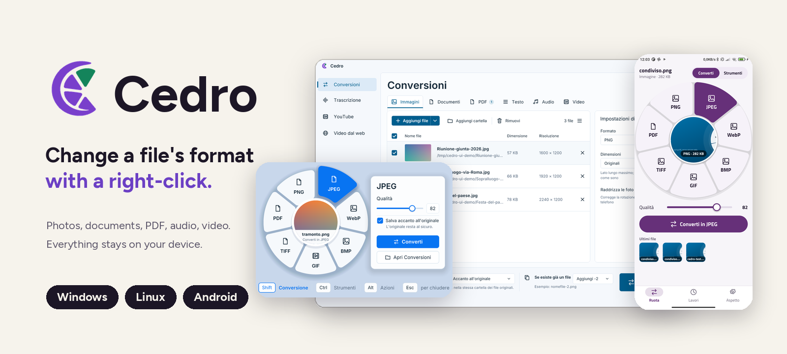

<p align="right">🇬🇧 English · <a href="README.md">🇮🇹 Italiano</a></p>

<p align="center">
  
</p>

<p align="center">
  <a href="https://github.com/realfulvio/cedro/releases/latest"></a>
  
  
  
  <a href="LICENSE"></a>
</p>

<p align="center">
  <a href="#download-and-install"><b>⬇ Download</b></a>
  &nbsp;·&nbsp; <a href="#how-to-use-it">How to use it</a>
  &nbsp;·&nbsp; <a href="#what-it-converts">Formats</a>
  &nbsp;·&nbsp; <a href="#more-than-conversion">Tools</a>
  &nbsp;·&nbsp; <a href="#cedro-for-android">Android</a>
  &nbsp;·&nbsp; <a href="#faq">FAQ</a>
</p>

## What is it

Cedro changes the format of your files without opening any program. Hold **Shift**, **right-click** a file and a wheel appears: pick the format and the new copy shows up next to the original, which stays untouched. On a phone, just tap **Share**.

Everything happens **on your own device**: your files are never uploaded anywhere. It is written entirely in **Rust**, and the code is open.

> The interface is currently available in Italian only; the screenshots below show the Italian version.

<p align="center">
  
</p>

## Download and install

| Your device | What to download |
| --- | --- |
| **Windows 10 and 11** | [`Cedro-Setup-….exe`](https://github.com/realfulvio/cedro/releases/latest) |
| **Windows on ARM** (Snapdragon X and similar) | [`Cedro-ARM64-Setup-….exe`](https://github.com/realfulvio/cedro/releases/latest): native build, faster transcription |
| **Linux** (Wayland with KDE Plasma or GNOME) | [`cedro-….-linux-x64.tar.gz`](https://github.com/realfulvio/cedro/releases/latest): extract it and run `./install.sh`, no admin rights needed |
| **Android** | coming soon: our own F-Droid repository, and APKs straight from the releases. Never on Google Play |

**Windows:** double-click the installer (it installs for your user only, no administrator rights). The first time, Windows may say "Windows protected your PC", because the installer is not yet code-signed: click *More info*, then *Run anyway*. At the end of the setup leave **Launch Cedro** ticked: no window opens, an icon appears next to the clock.

**Linux:** Cedro stays in the notification area and writes the file manager menus by itself. On GNOME you need the AppIndicator extension to see the icon.

After the first install it updates itself. To remove it: *Windows Settings, Apps, Cedro* (Linux: `./install.sh --uninstall`).

<p align="center">
  
</p>

## How to use it

1. Hold down a key.
2. **Right-click** a file: in File Explorer, on the desktop, in your file manager or in an Open/Save dialog.
3. Left-click the slice you want. Esc, or a click outside the wheel, cancels.

| Key | Wheel | What it does |
| --- | --- | --- |
| **Shift** | Conversion | Changes format: photos, documents, PDF, audio, video |
| **Ctrl** | Tools | Compress, scale, black and white, rotate, strip metadata, read text (OCR) |
| **Alt** | Actions | Duplicate, copy the path, create a ZIP |

The slices change with the file type. Not sure where to start? Open the **Guide** from the icon: six animated steps.

<p align="center">
  
  
  
</p>

## What it converts

| Type | Formats | With Shift |
| --- | --- | --- |
| Images | PNG, JPEG, WebP, BMP, GIF, TIFF | other format, searchable PDF |
| Documents | DOCX, DOC, ODT, RTF | PDF |
| Text | TXT, MD, CSV, JSON, HTML, XML | other text, PDF |
| PDF | PDF | JPG, **editable Word** |
| Audio | WAV, MP3, OGG, M4A, AAC, FLAC | WAV, MP3 |
| Video | MP4, WebM, MOV, MKV, AVI | MP4 |

**PDF to Word:** real heading styles, paragraphs, real tables (cells, shading, borders, header row repeated across pages), bulleted and numbered lists, multi-column text and graphics kept in place, editable like in a professional editor. Scans are read with OCR.
**Phone photos:** automatically straightened.

## More than conversion

<p align="center">
  
</p>

**Conversions.** Open the panel from the icon menu: drag in files, even of different types, choose format, tools, quality and destination, and press the button at the bottom. Each category has its own options: photos (size, straighten, white background), documents (page size, embedded fonts, bookmarks, PDF/A-1b validated with veraPDF, password), PDF (OCR, tables, columns, pages like `1-3,5`, resolution), text, audio (kbps, channels, volume, trimming, tags) and video (resolution, fps, no audio, web-optimised). If the output name already exists: add `-2`, replace, skip or ask every time.

<table>
  <tr>
    <td width="50%"></td>
    <td width="50%"></td>
  </tr>
  <tr>
    <td><b>Transcription.</b> From audio and video to a Word document or plain text, locally (whisper.cpp). It picks the right build for your processor, with Vulkan on the graphics card.</td>
    <td><b>YouTube and Web video.</b> Download video or audio only with quality, subtitles, cover art and chapters; the "Web video" tab also works with any page.</td>
  </tr>
</table>

External components such as yt-dlp, deno, ffmpeg and the transcription engine are downloaded on first use and **update themselves**; licences are listed in *About*.

## Five looks, two modes

The interface is entirely hand-drawn in Rust, identical on Windows and Linux. In **Settings › Appearance** you choose between layouts (the wheel is always the same) and between **Standard** mode, with every option within reach, and **Simplified**, with just the essentials. The **Comune di Bondeno** theme brings the municipality's colours, typeface and coat of arms.

<p align="center">
  
</p>

## Cedro for Android

The same features as the desktop, designed for touch: from the gallery or the file manager tap **Share → Cedro**, pick on the wheel (with the file at the centre) and convert. Jobs are kept in a list with progress, and there are five themes to choose from.

<p align="center">
  
</p>

The app is a prototype and **does not go through Google Play**: you install it from our F-Droid repository (hosted on GitHub Pages) or as an APK from the releases. All the code is Rust, plus one tiny Java class for system integration.

## FAQ

**Does it change the original file?** No, it always makes a copy next to it.
**Does it need internet?** Only for updates and to download components the first time (and, of course, for YouTube and Web video).
**Why does Windows warn me?** The installer doesn't have the paid code signature yet. The code is open and you can inspect it here.
**What about Mac?** Not for now: Windows, Linux (Wayland) and Android.

---

## For developers

<details>
<summary><b>Building, command line, security, licences</b></summary>

### Building

You need [Rust](https://rustup.rs).

```
cargo build --release
```

- **Windows:** Microsoft C++ build tools. For the installer you need [Inno Setup 6](https://jrsoftware.org/isinfo.php) and `pwsh installer\build.ps1` (with `-Arm64` for Windows on ARM; the ARM64 transcription engine is built with `trascrivi\build.ps1` on an ARM PC and also requires LLVM).
- **Linux:** a C compiler, `pkgconf` and the GTK 4 development packages. The first build also compiles OpenH264, FDK AAC and LAME. Run `cedro` once: it stays in the tray and writes the file menus. On GNOME the AppIndicator extension is needed for the icon.
  - Package: `installer/build-linux.sh` creates `dist/cedro-<version>-linux-x64.tar.gz` (program, licences and `install.sh`, which installs for the user without admin rights).
  - Transcription: the engine (whisper.cpp) is built separately with `trascrivi/build.sh`, one variant per processor type (`base`, `avx2`, `avxvnni`, `avx512`, `avx512vnni`) plus `vulkan` for the graphics card. You need cmake, clang and libopus; for Vulkan the headers, `glslc` and the loader. The `cedro-trascrivi-<version>-linux-x64-<variant>` files go in the release: Cedro downloads them the first time you transcribe.

Settings live in `%APPDATA%\Cedro\config.txt` (Windows) and `~/.config/cedro/config.txt` (Linux).

### Command line

```
cedro convert foto.png webp
cedro tool foto.png compress --quality 70
cedro zip nota.txt
cedro update
cedro show --conversione foto.png   # Linux: opens the wheel
```

### Security

Open source (MIT), no packer or obfuscation, no network use beyond update checks. The mouse and keyboard hooks stay inside Cedro's own process and don't inject DLLs into other programs. The exe is not Authenticode-signed: SmartScreen warns the first time, but that is not a malware detection.

### Licences

Cedro is MIT. Some parts have their own licence: LAME (LGPL, MP3), the ocrs OCR model (CC BY-SA 4.0, sources in `models/FONTI.txt`), [oxideav-vp8](https://github.com/OxideAV/oxideav-vp8) and [oxideav-vp9](https://github.com/OxideAV/oxideav-vp9) (MIT), OpenH264 (BSD-2) and FDK AAC (Fraunhofer licence). Cedro is a from-scratch implementation and uses no code, icons or text from other converters.

</details>

---

## Credits

Cedro is a project by **Luca "Realhcok" A.**, written from scratch in Rust: it uses no code, icons or text from other converters. Fonts [Figtree](https://github.com/erikdkennedy/figtree) and Titillium Web (SIL OFL), hcok logo and brand kit. Thanks to the **Comune di Bondeno** for the dedicated theme. Third-party licences are in [`LICENZE-DI-TERZE-PARTI.txt`](LICENZE-DI-TERZE-PARTI.txt) and in Cedro's *About* tab.

<p align="center">
  Powered by Luca "Realhcok" A.
</p>
