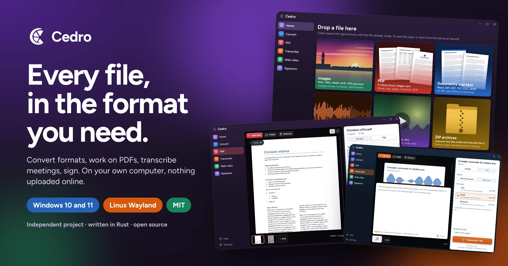
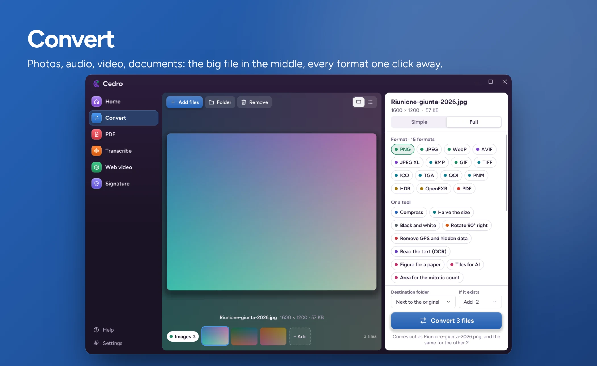
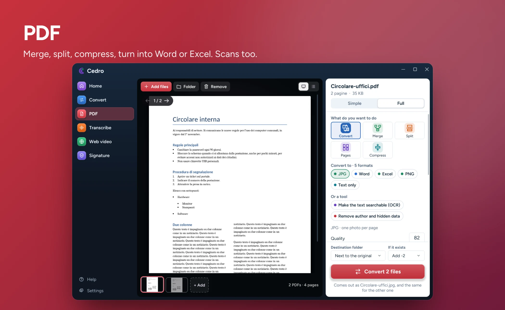
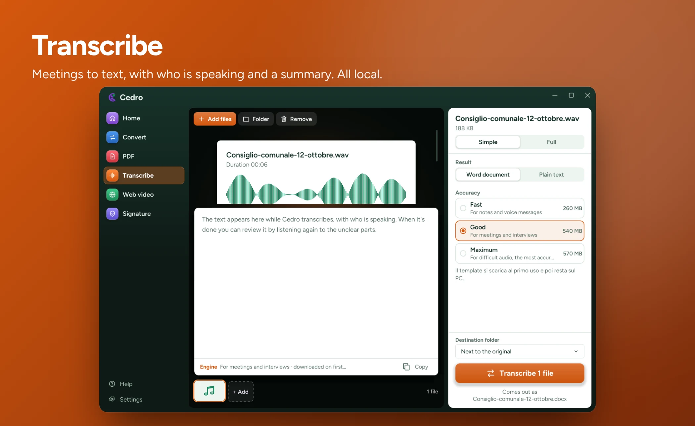
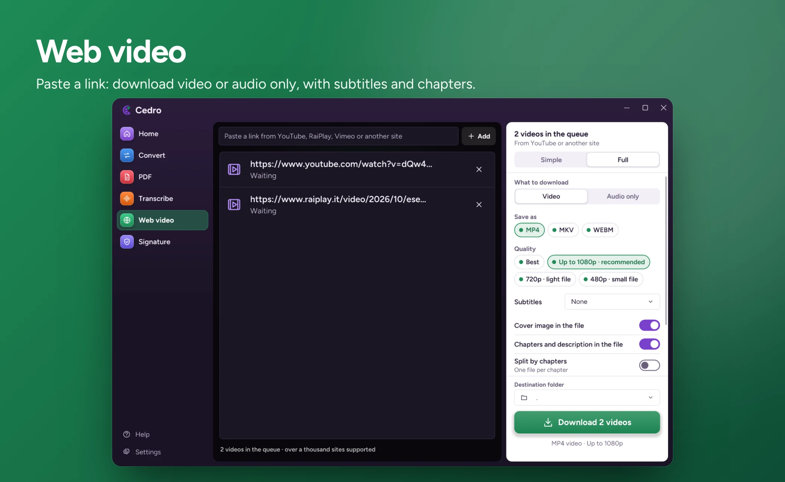
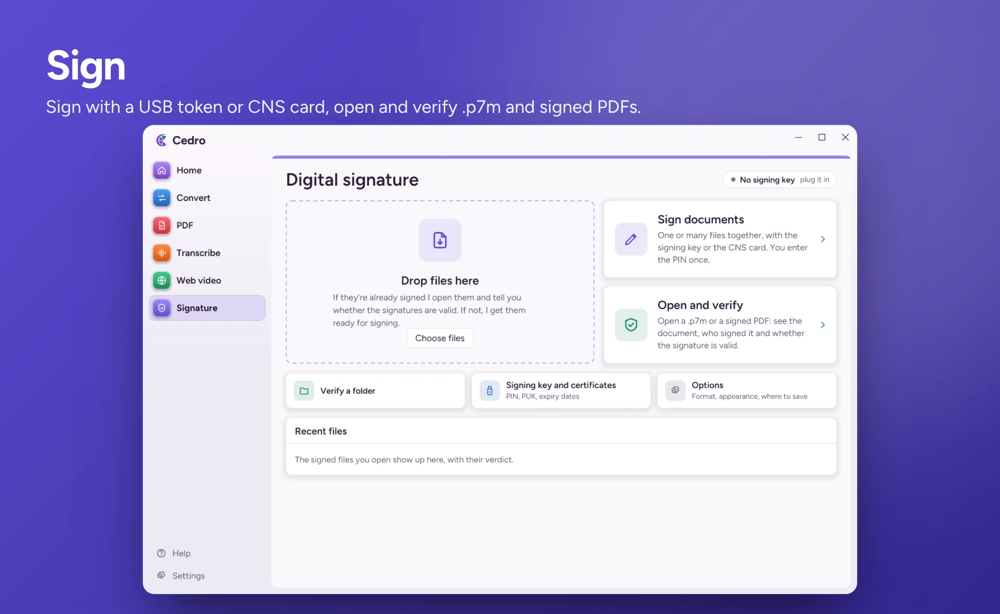
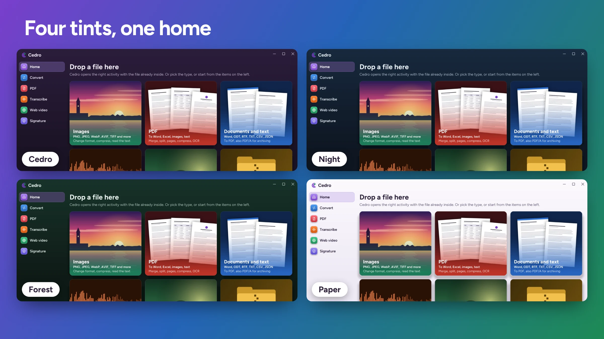
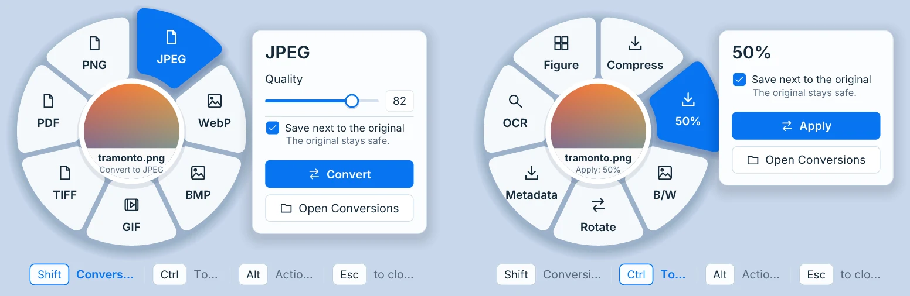
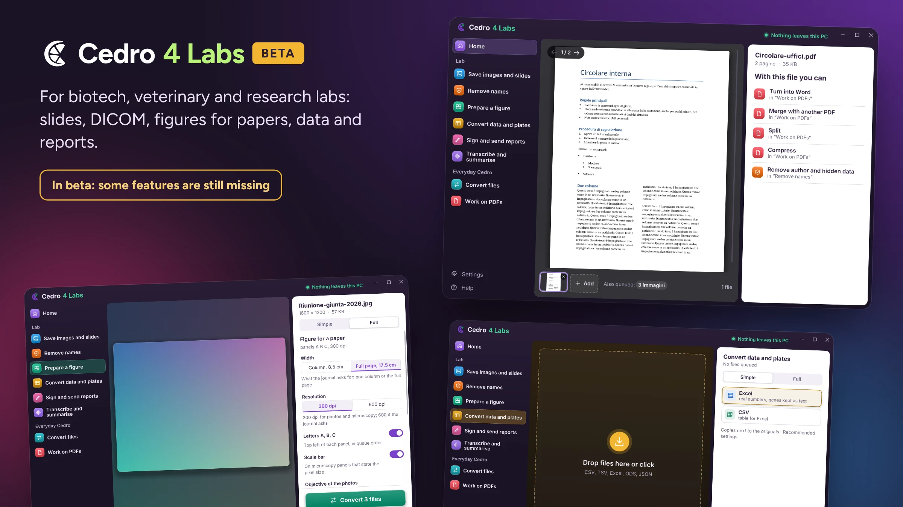

<p align="right">🇬🇧 English · <a href="README.md">🇮🇹 Italiano</a></p>

<p align="center">
  
</p>

<p align="center">
  <a href="https://github.com/realfulvio/cedro/releases/latest"></a>
  
  
  <a href="#cedro-4-labs-beta"></a>
  <a href="https://github.com/realfulvio/cedro/releases/latest"></a>
  <a href="LICENSE"></a>
</p>

<p align="center">
  <a href="#download-and-install"><b>⬇ Download</b></a>
  &nbsp;·&nbsp; <a href="#how-to-use-it">How to use it</a>
  &nbsp;·&nbsp; <a href="#what-it-converts">Formats</a>
  &nbsp;·&nbsp; <a href="#more-than-conversion">Tools</a>
  &nbsp;·&nbsp; <a href="#transcription-and-summary">Transcription</a>
  &nbsp;·&nbsp; <a href="#cedro-4-labs-beta">Cedro 4 Labs</a>
  &nbsp;·&nbsp; <a href="#all-releases">Releases</a>
  &nbsp;·&nbsp; <a href="#faq">FAQ</a>
</p>

## What is it

**Cedro is a program in its own right: a one-of-a-kind, independent project.** It is not a copy of a converter and does not depend on online services or other programs: it is written from scratch, entirely in **Rust**, with its own engine for images, PDFs, documents, audio and video. The code is open and the interface comes in English and Italian (it follows your system language).

One window, many activities: **change the format** of photos, audio, video and documents; **work on PDFs** (merge, split, compress, turn into Word or Excel, scans too with OCR); **transcribe meetings**, recognise **who is speaking** and write the **summary**; **download video and audio** from the web; **sign** with a USB token or smart card (CNS) and verify signed files. The file stays at the centre, every command is in view, and the new copy shows up next to the original, which is never touched.

Everything happens **on your own computer**: your files are never uploaded anywhere.

Are you a biotech, veterinary or research lab? There is also **[Cedro 4 Labs](#cedro-4-labs-beta)**, now in beta.

## What it looks like

<p align="center">
  
  
</p>
<p align="center">
  
  
</p>
<p align="center">
  
  
</p>

Since 0.44 the default look is the new paged **Cedro** one, with four tints (Cedro, Night, Forest, Paper) and a **Simple** or **Full** view one click away. The five earlier looks, including the **Comune di Bondeno** one, are still in *Settings › Appearance*. Some labels in the screenshots are still shown in Italian.

## Download and install

| Your device | What to download |
| --- | --- |
| **Windows 10 and 11** | [`Cedro-Setup-….exe`](https://github.com/realfulvio/cedro/releases/latest) |
| **Windows 10 and 11, portable** | [`Cedro-Portable-….-x64.zip`](https://github.com/realfulvio/cedro/releases/latest): extract and open `cedro.exe`, nothing to install; data and settings stay in the `Dati` folder next to the exe (x64 only) |
| **Windows on ARM** | paused: the last version is 0.39.1, from 0.40 releases are x64 only |
| **Linux** (Wayland with KDE Plasma or GNOME) | [`cedro-….-linux-x64.tar.gz`](https://github.com/realfulvio/cedro/releases/latest): extract it and run `./install.sh`, no admin rights needed |
| **Android** | development paused (latest: 0.28.0): signed APK from the [releases](https://github.com/realfulvio/cedro/releases?q=android-v) and our own F-Droid repository `https://realfulvio.github.io/cedro/fdroid/repo`. Never on Google Play |

**Windows:** double-click the installer (it installs for your user only, no administrator rights). The first time, Windows may say "Windows protected your PC", because the installer is not yet code-signed: click *More info*, then *Run anyway*. At the end of the setup leave **Launch Cedro** ticked: no window opens, an icon appears next to the clock.

**Linux:** Cedro stays in the notification area and writes the file manager menus by itself. On GNOME you need the AppIndicator extension to see the icon.

After the first install it updates itself. To remove it: *Windows Settings, Apps, Cedro* (Linux: `./install.sh --uninstall`).

**Antivirus check:** every file of every release is automatically scanned on [VirusTotal](https://www.virustotal.com) with 70+ antivirus engines; the result, with a link to each file's report, is at the bottom of the [release](https://github.com/realfulvio/cedro/releases/latest) notes. Nobody can promise "zero viruses" forever, but you can check it yourself: compare the SHA-256 of your download with the one in the report.

## The right-click wheel

Besides the window, Cedro has the **wheel**: turn it on in *Settings › Wheel*.

1. Hold down a key.
2. **Right-click** a file: in File Explorer, on the desktop, in your file manager or in an Open/Save dialog.
3. Left-click the slice you want. Esc, or a click outside the wheel, cancels.

| Key | Wheel | What it does |
| --- | --- | --- |
| **Shift** | Conversion | Changes format: photos, documents, PDF, audio, video |
| **Ctrl** | Tools | Compress, scale, black and white, rotate, strip metadata, read text (OCR) |
| **Alt** | Actions | Duplicate, copy the path, create a ZIP |

The slices change with the file type. Not sure where to start? Open the **Guide** from the icon: six animated steps.

<p align="center">
  
</p>

## What it converts

| Type | Formats | With Shift |
| --- | --- | --- |
| Images | PNG, JPEG, WebP, AVIF, JPEG XL, **SVG**, BMP, GIF, TIFF, ICO, TGA, QOI, PNM, HDR, OpenEXR, DDS | other format, searchable PDF; the Conversions panel adds AVIF, JPEG XL (lossless), ICO, TGA, QOI, PNM, HDR, OpenEXR |
| Documents | DOCX, DOC, ODT, RTF | PDF |
| Text | TXT, MD, CSV, JSON, HTML, XML | other text, PDF |
| PDF | PDF | JPG, **editable Word** |
| Audio | WAV, MP3, OGG, **Opus**, M4A, AAC, FLAC, AIFF, CAF | WAV, MP3; the panel adds FLAC, Opus, AIFF |
| Video | MP4, WebM, MOV, MKV, AVI | MP4 |
| Archives | ZIP | photos to WebP/JPEG/PNG, audio to MP3/WAV, documents to PDF: converts the files inside the ZIP and rebuilds it |

**PDF to Word:** real heading styles, paragraphs, real tables (cells, shading, borders, header row repeated across pages), bulleted and numbered lists, multi-column text and graphics kept in place, editable like in a professional editor. Scans are read with OCR.
**Phone photos:** automatically straightened.
**Files are recognised by content:** a WebP photo named ".jpg" still converts. **Output names from a template** (`%name%_%date%`) in the Conversions panel.

## More than conversion

**Conversions.** Open the panel from the icon menu: drag in files, even of different types, choose format, tools, quality and destination, and press the button at the bottom. Each category has its own options: photos (size, straighten, white background), documents (page size, embedded fonts, bookmarks, PDF/A-1b validated with veraPDF, password), PDF (OCR, tables, columns, pages like `1-3,5`, resolution), text, audio (kbps, channels, volume, trimming, tags) and video (resolution, fps, no audio, web-optimised). If the output name already exists: add `-2`, replace, skip or ask every time.

### Transcription and summary

**Transcription.** From audio and video to a Word document, plain text or subtitles, in Italian and locally (whisper.cpp). It picks the right build for your processor and uses the graphics card through Vulkan when there is one. Three accuracy levels, and a progress bar with the time left.

**Who speaks.** It recognises the speakers and colours them; give each voice a name in the "Who's speaking" tab and it applies to the whole document.

**AI summary.** With one click a small Italian-language model (llama.cpp, Qwen3.5-4B) writes the summary and "who said what". It loads only when you ask and then shuts down. Doubtful figures and votes are flagged *to check*.

External components such as yt-dlp, deno, ffmpeg and the transcription engine are downloaded on first use and **update themselves**; licences are listed in *About*.

## Cedro 4 Labs (beta)

<p align="center">
  
</p>

**Cedro 4 Labs** is the Cedro look designed for biotech, veterinary and research labs, and their office: six activities instead of file types ("Save images and slides", "Remove names", "Prepare a figure", "Convert data and plates", "Sign and send reports", "Transcribe and summarise"), plus the usual pages. Choose it in the installer or in *Settings › Appearance*.

> ⚠️ **It is in beta: some features are still missing and others need polish.** If you use it in a lab, check the results and tell us what looks wrong.

| | Already there | Still missing |
| --- | --- | --- |
| Images | Digital slides `.svs` to image, DICOM (also anonymised), Zeiss CZI, ND2 and LIF, OME-TIFF, figure for a paper with a scale bar | Hamamatsu NDPI, 3DHistech MRXS, VSI; DICOM from CD with DICOMDIR |
| Data | CSV/TSV ↔ Excel, data package with SHA-256 fingerprints (BagIt) | Colour plate map |
| Privacy | Strips names, authors, GPS and hidden data from PDF, Office, photos and DICOM | More proprietary formats |
| Voice | Transcription with a veterinary glossary, summary | Report polishing |

Everything stays on your computer, as in standard Cedro. If your lab misses a format or a feature, [open an issue](https://github.com/realfulvio/cedro/issues).

## All releases

Since 21 October 2026, **90 versions** have come out for Windows and Linux. The latest:

| Version | Date | What's new |
| --- | --- | --- |
| [0.45.0](https://github.com/realfulvio/cedro/releases/tag/v0.45.0) | 12/11 | Cedro 4 Labs reads Zeiss CZI files |
| [0.44.2](https://github.com/realfulvio/cedro/releases/tag/v0.44.2) | 12/11 | Quality fixes for Cedro 4 Labs |
| [0.44.0](https://github.com/realfulvio/cedro/releases/tag/v0.44.0) | 12/11 | New paged "Cedro" look with four tints |
| [0.43.0](https://github.com/realfulvio/cedro/releases/tag/v0.43.0) | 12/11 | Cedro 4 Labs with the paged window |
| [0.42.0](https://github.com/realfulvio/cedro/releases/tag/v0.42.0) | 12/11 | Lab features (DICOM, ND2/LIF, figure, data package) |
| [0.41.0](https://github.com/realfulvio/cedro/releases/tag/v0.41.0) | 12/11 | Portable version for Windows |
| [0.40.0](https://github.com/realfulvio/cedro/releases/tag/v0.40.0) | 12/11 | Cedro 4 Labs theme and look choice in the installer |
| [0.39.0](https://github.com/realfulvio/cedro/releases/tag/v0.39.0) | 11/11 | Digital slides (.svs) |
| [0.38.0](https://github.com/realfulvio/cedro/releases/tag/v0.38.0) | 10/11 | Signing with a USB token or smart card |
| [0.31.0](https://github.com/realfulvio/cedro/releases/tag/v0.31.0) | 03/11 | AI summary of meetings |
| [0.26.10](https://github.com/realfulvio/cedro/releases/tag/v0.26.10) | 29/10 | Merge and split PDFs |
| [0.22.0](https://github.com/realfulvio/cedro/releases/tag/v0.22.0) | 27/10 | English interface |
| [0.6.0](https://github.com/realfulvio/cedro/releases/tag/v0.6.0) | 21/10 | Cedro comes to Linux |
| [0.1.0](https://github.com/realfulvio/cedro/releases/tag/v0.1.0) | 21/10 | First version |

**[→ The full log, version by version](docs/RILASCI.md)** (in Italian) · [all releases on GitHub](https://github.com/realfulvio/cedro/releases)

## FAQ

**Does it change the original file?** No, it always makes a copy next to it.
**Does it need internet?** Only for updates and to download components the first time (and, of course, for YouTube and Web video).
**Why does Windows warn me?** The installer doesn't have the paid code signature yet. The code is open and you can inspect it here.
**What about Mac?** Not for now: Windows and Linux (Wayland). Android is paused.

---

## For developers

<details>
<summary><b>Building, command line, security, licences</b></summary>

### Building

You need [Rust](https://rustup.rs).

```
cargo build --release
```

- **Windows:** Microsoft C++ build tools. For the installer you need [Inno Setup 6](https://jrsoftware.org/isinfo.php) and `pwsh installer\build.ps1` (with `-Arm64` for Windows on ARM; the ARM64 transcription engine is built with `trascrivi\build.ps1` on an ARM PC and also requires LLVM).
- **Linux:** a C compiler, `pkgconf` and the GTK 4 development packages. The first build also compiles OpenH264, FDK AAC and LAME. Run `cedro` once: it stays in the tray and writes the file menus. On GNOME the AppIndicator extension is needed for the icon.
  - Package: `installer/build-linux.sh` creates `dist/cedro-<version>-linux-x64.tar.gz` (program, licences and `install.sh`, which installs for the user without admin rights).
  - Transcription: the engine (whisper.cpp) is built separately with `trascrivi/build.sh`, one variant per processor type (`base`, `avx2`, `avxvnni`, `avx512`, `avx512vnni`) plus `vulkan` for the graphics card. You need cmake and clang (libopus is built in); for Vulkan the headers, `glslc` and the loader. The `cedro-trascrivi-<version>-linux-x64-<variant>` files go in the release: Cedro downloads them the first time you transcribe.

Settings live in `%APPDATA%\Cedro\config.txt` (Windows) and `~/.config/cedro/config.txt` (Linux).

### Command line

```
cedro convert foto.png webp
cedro tool foto.png compress --quality 70
cedro zip nota.txt
cedro update
cedro show --conversione foto.png   # Linux: opens the wheel
```

### Security

Open source (MIT), no packer or obfuscation, no network use beyond update checks. The mouse and keyboard hooks stay inside Cedro's own process and don't inject DLLs into other programs. The exe is not Authenticode-signed: SmartScreen warns the first time, but that is not a malware detection.

### Licences

Cedro is MIT. Some parts have their own licence: LAME (LGPL, MP3), the ocrs OCR model (CC BY-SA 4.0, sources in `models/FONTI.txt`), [oxideav-vp8](https://github.com/OxideAV/oxideav-vp8), [oxideav-vp9](https://github.com/OxideAV/oxideav-vp9) and [oxideav-webp](https://github.com/OxideAV/oxideav-webp) (MIT), OpenH264 (BSD-2) and FDK AAC (Fraunhofer licence). Cedro is a from-scratch implementation and uses no code, icons or text from other converters.

</details>

---

## Credits

Cedro is a project by **Luca "Realhcok" A.**, written from scratch in Rust: it uses no code, icons or text from other converters. Fonts [Figtree](https://github.com/erikdkennedy/figtree) and Titillium Web (SIL OFL), hcok logo and brand kit. Thanks to the **Comune di Bondeno** for the dedicated theme. Third-party licences are in [`LICENZE-DI-TERZE-PARTI.txt`](LICENZE-DI-TERZE-PARTI.txt) and in Cedro's *About* tab.

<p align="center">
  Powered by Luca "Realhcok" A.
</p>
