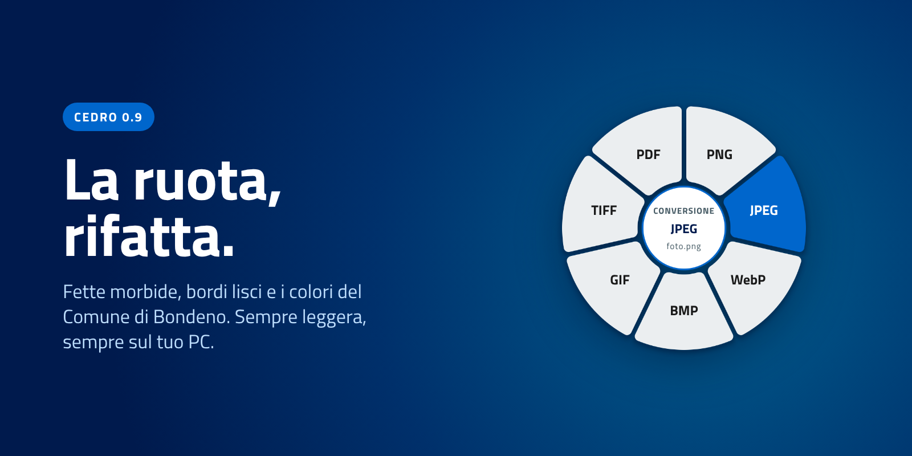

<p align="center">
  
</p>

<h1 align="center">Cedro</h1>

<p align="center">
  <strong>Converti qualsiasi file con un clic destro. Sul tuo PC, senza caricare nulla.</strong>
</p>

<p align="center">
  <a href="https://github.com/realfulvio/cedro/releases/latest"></a>
  
  <a href="LICENSE"></a>
</p>

<p align="center">
  
</p>

<p align="center">
  
  &nbsp;&nbsp;
  
  <br><sub>Screenshot veri su Windows 11: la ruota e le Impostazioni.</sub>
</p>

## Cosa fa

Tieni premuto un tasto, fai clic destro su un file e si apre una ruota sul cursore. Clicca una fetta e la copia convertita compare nella stessa cartella. L'originale non si tocca.

Immagini, documenti, PDF, audio e video: tutto dentro il programma. Niente LibreOffice, ffmpeg, Tesseract o Poppler da installare. Nessun caricamento, nessuna telemetria.

## Scarica

**[Scarica l'ultima versione](https://github.com/realfulvio/cedro/releases/latest)**

- **Windows:** `Cedro-Setup-x.y.z.exe`. Si installa per il tuo utente, senza diritti di amministratore. La prima volta Windows può dire «Windows ha protetto il PC» (l'installatore non è firmato): *Ulteriori informazioni*, poi *Esegui comunque*.
- **Linux:** si compila da sorgente, vedi [Compilare](#compilare).

Cedro resta vicino all'orologio, senza finestre. Si aggiorna da solo.

## Come si usa

<p align="center">
  
</p>

Tieni premuto un tasto e fai **clic destro** su un file, in Esplora file, sul desktop o in una finestra Apri/Salva. Poi clic sinistro sulla fetta. Esc o un clic fuori annulla.

| Tasto | Ruota | Serve a |
| --- | --- | --- |
| **Shift** | Conversione | Cambiare formato |
| **Ctrl** | Strumenti | Comprimere, scalare, bianco e nero, ruotare, togliere i metadati, OCR |
| **Alt** | Azioni | Duplicare, copiare il percorso, creare uno ZIP |

Le fette cambiano con il tipo di file. Su Linux la ruota si apre dal menu del file (Dolphin, Nautilus), perché Wayland non lascia intercettare il clic destro.

## Cosa converte

| Tipo | Formati | Con Shift |
| --- | --- | --- |
| Immagini | PNG, JPEG, WebP, BMP, GIF, TIFF | altro formato, PDF con testo cercabile |
| Documenti | DOCX, DOC, ODT, RTF | PDF |
| Testo | TXT, MD, CSV, JSON, HTML, XML | altro testo, PDF |
| PDF | PDF | JPG, **Word fedele all'originale** |
| Audio | WAV, MP3, OGG, M4A, AAC, FLAC | WAV, MP3 |
| Video | MP4, WebM, MOV, MKV, AVI | MP4 (H.264 + AAC) |

- **PDF in Word fedele:** stesso carattere, corpo, colore e posizione del testo. Le scansioni vengono lette con l'OCR in italiano.
- **OCR in italiano** su Windows (OCR di sistema) e su Linux (Tesseract, se installato).
- Foto del telefono raddrizzate in automatico.

## Impostazioni e aggiornamenti

Menu dell'icona (o doppio clic): **Impostazioni**, **Guida** (animazione che mostra cosa fanno Shift, Ctrl e Alt; l'installatore la propone anche a fine installazione), **Controlla aggiornamenti**, **Avvio automatico**, **Esci**.

- Tasti che aprono la ruota, avvio con Windows, avviso a fine conversione.
- Qualità di JPEG, WebP, MP3 e PDF in JPG.
- Cedro cerca da solo le nuove versioni su GitHub, verifica l'installatore con SHA-256 e chiede prima di aggiornare.

Le impostazioni stanno in `%APPDATA%\Cedro\config.txt` (Windows) e `~/.config/cedro/config.txt` (Linux). Il registro delle novità è nelle [release](https://github.com/realfulvio/cedro/releases).

## Da riga di comando

```
cedro convert foto.png webp
cedro tool foto.png compress --quality 70
cedro zip nota.txt
cedro update
```

## Compilare

Serve [Rust](https://rustup.rs).

```
cargo build --release
```

- **Windows:** strumenti di compilazione Microsoft C++. Per l'installatore serve [Inno Setup 6](https://jrsoftware.org/isinfo.php) e `pwsh installer\build.ps1`.
- **Linux:** compilatore C, `pkgconf` e i pacchetti di sviluppo di GTK 4. La prima volta compila anche OpenH264, FDK AAC e LAME.

## Sicurezza

Codice aperto (MIT), nessun packer né offuscamento, nessuna rete oltre al controllo aggiornamenti. Gli hook del mouse e della tastiera restano nel processo di Cedro e non iniettano DLL in altri programmi. L'exe non è firmato Authenticode: SmartScreen avvisa la prima volta, ma non è un rilevamento di malware.

## Licenze

Cedro è MIT. Alcune parti hanno la propria licenza: LAME (LGPL, MP3), modello OCR ocrs (CC BY-SA 4.0, fonti in `models/FONTI.txt`), [oxideav-vp8](https://github.com/OxideAV/oxideav-vp8) e [oxideav-vp9](https://github.com/OxideAV/oxideav-vp9) (MIT), OpenH264 (BSD-2) e FDK AAC (licenza Fraunhofer). Cedro è un'implementazione scritta da zero e non usa codice, icone o testi di altri convertitori.

---

<p align="center">
  Powered by Luca "Realhcok" A.
</p>
