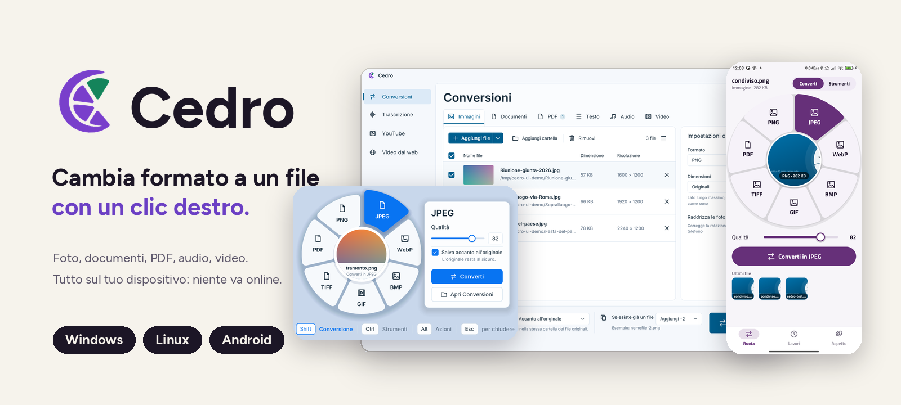
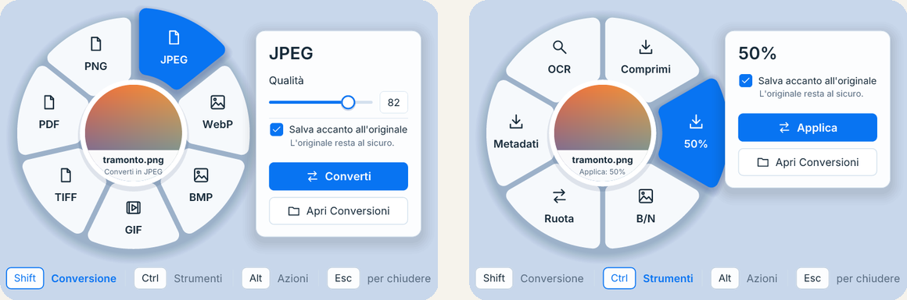
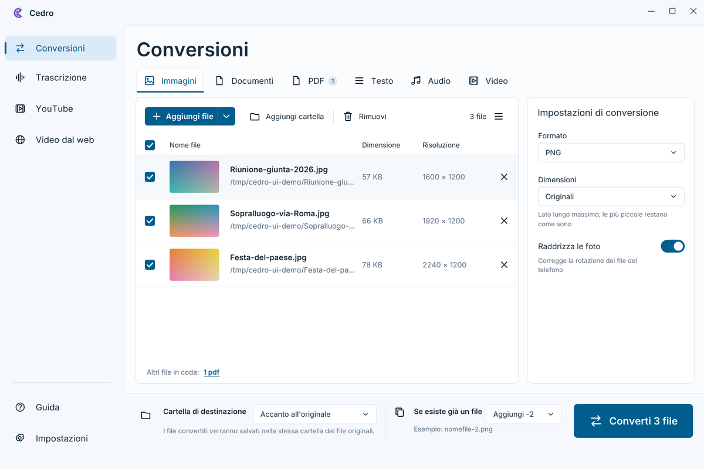
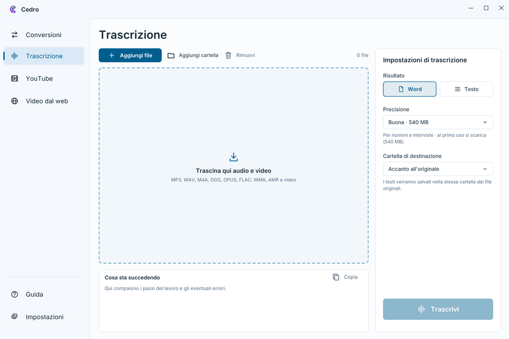
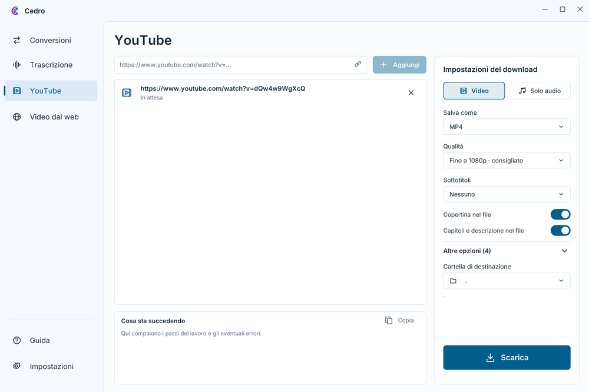
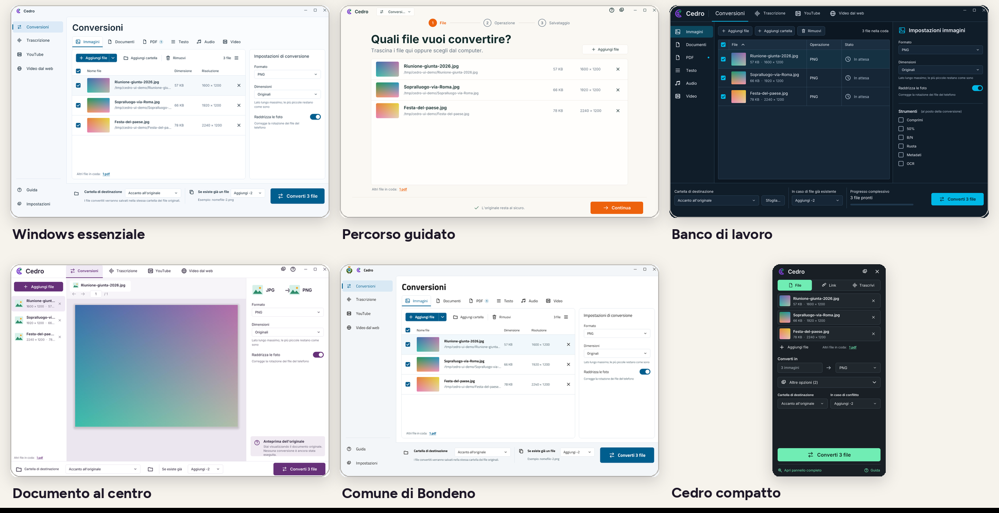
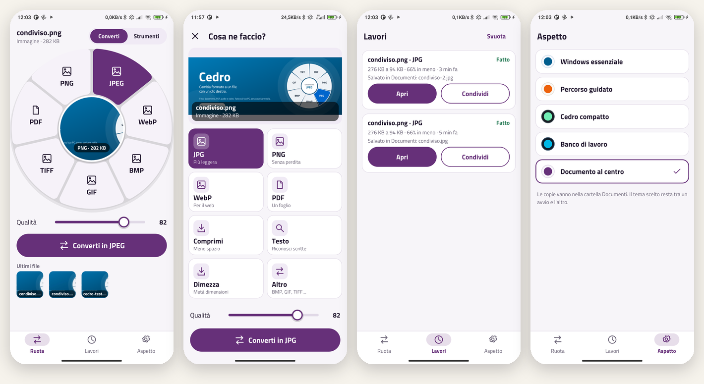

<p align="right"><a href="README.en.md">🇬🇧 English</a> · 🇮🇹 Italiano</p>

<p align="center">
  
</p>

<p align="center">
  <a href="https://github.com/realfulvio/cedro/releases/latest"></a>
  
  
  
  <a href="LICENSE"></a>
</p>

<p align="center">
  <a href="#scarica-e-installa"><b>⬇ Scarica</b></a>
  &nbsp;·&nbsp; <a href="#come-si-usa">Come si usa</a>
  &nbsp;·&nbsp; <a href="#cosa-converte">Formati</a>
  &nbsp;·&nbsp; <a href="#più-di-una-conversione">Strumenti</a>
  &nbsp;·&nbsp; <a href="#cedro-per-android">Android</a>
  &nbsp;·&nbsp; <a href="#domande">Domande</a>
</p>

## Cos'è

Cedro cambia formato ai tuoi file senza farti aprire nessun programma. Tieni premuto **Shift**, fai **clic destro** su un file e si apre una ruota: scegli il formato e la copia nuova compare accanto all'originale, che resta com'era. Su telefono basta toccare **Condividi**.

Tutto avviene **sul tuo dispositivo**: i file non vengono caricati da nessuna parte. È scritto interamente in **Rust**, è in italiano e in inglese (segue la lingua del sistema) e il codice è aperto.

<p align="center">
  
</p>

## Scarica e installa

| Il tuo dispositivo | Cosa scaricare |
| --- | --- |
| **Windows 10 e 11** | [`Cedro-Setup-….exe`](https://github.com/realfulvio/cedro/releases/latest) |
| **Windows on ARM** (Snapdragon X e simili) | [`Cedro-ARM64-Setup-….exe`](https://github.com/realfulvio/cedro/releases/latest): versione nativa, più veloce nella trascrizione |
| **Linux** (Wayland con KDE Plasma o GNOME) | [`cedro-….-linux-x64.tar.gz`](https://github.com/realfulvio/cedro/releases/latest): estrai e lancia `./install.sh`, senza permessi di amministratore |
| **Android** | APK firmato dalle [release](https://github.com/realfulvio/cedro/releases/tag/android-v0.22.1) (dalla 0.21.3) e repository F-Droid nostro: `https://realfulvio.github.io/cedro/fdroid/repo`. Mai su Google Play |

**Windows:** doppio clic sull'installatore (si installa solo per il tuo utente, senza diritti di amministratore). Alla prima esecuzione Windows può dire «Windows ha protetto il PC», perché l'installatore non è ancora firmato: *Ulteriori informazioni*, poi *Esegui comunque*. A fine installazione lascia spuntato **Avvia Cedro**: non si apre una finestra, compare l'icona vicino all'orologio.

**Linux:** Cedro resta nell'area di notifica e scrive da solo i menu del file manager. Su GNOME serve l'estensione AppIndicator per vedere l'icona.

Dopo la prima installazione si aggiorna da solo. Per toglierlo: *Impostazioni di Windows, App, Cedro* (Linux: `./install.sh --uninstall`).

<p align="center">
  
</p>

## Come si usa

1. Tieni premuto un tasto.
2. Fai **clic destro** su un file: in Esplora file, sul desktop, nel file manager o in una finestra Apri/Salva.
3. Clic sinistro sulla fetta che vuoi. Esc, o un clic fuori dalla ruota, annulla.

| Tasto | Ruota | Cosa fa |
| --- | --- | --- |
| **Shift** | Conversione | Cambia formato: foto, documenti, PDF, audio, video |
| **Ctrl** | Strumenti | Comprime, scala, bianco e nero, ruota, toglie i metadati, legge il testo (OCR) |
| **Alt** | Azioni | Duplica, copia il percorso, crea uno ZIP |

Le fette cambiano con il tipo di file. Se non sai da dove partire, apri la **Guida** dall'icona: sei passi animati.

<p align="center">
  
  
  
</p>

## Cosa converte

| Tipo | Formati | Con Shift |
| --- | --- | --- |
| Immagini | PNG, JPEG, WebP, AVIF, JPEG XL, **SVG**, BMP, GIF, TIFF, ICO, TGA, QOI, PNM, HDR, OpenEXR, DDS | altro formato, PDF con testo cercabile; nel pannello Conversioni anche AVIF, JPEG XL (senza perdita), ICO, TGA, QOI, PNM, HDR, OpenEXR |
| Documenti | DOCX, DOC, ODT, RTF | PDF |
| Testo | TXT, MD, CSV, JSON, HTML, XML | altro testo, PDF |
| PDF | PDF | JPG, **Word modificabile** |
| Audio | WAV, MP3, OGG, **Opus**, M4A, AAC, FLAC, AIFF, CAF | WAV, MP3; nel pannello anche FLAC, Opus, AIFF |
| Video | MP4, WebM, MOV, MKV, AVI | MP4 |
| Archivi | ZIP | foto in WebP/JPEG/PNG, audio in MP3/WAV, documenti in PDF: converte i file dentro lo ZIP e lo rifà |

**PDF in Word:** titoli con stili veri, paragrafi, tabelle vere (celle, sfondi, bordi, intestazione ripetuta tra le pagine), elenchi puntati e numerati, testo su più colonne e grafici al loro posto, modificabili come in un editor professionale. Le scansioni vengono lette con l'OCR in italiano.
**Foto dal telefono:** vengono raddrizzate in automatico.
**Riconosce i file dal contenuto:** una foto WebP chiamata «.jpg» si converte lo stesso. **Nome dei file a modello** (`%nome%_%data%`) nel pannello Conversioni.

## Più di una conversione

<p align="center">
  
</p>

**Conversioni.** Dal menu dell'icona apri il pannello: trascini file anche di tipi diversi, scegli formato, strumenti, qualità e cartella, e premi il pulsante in basso. Ogni categoria ha le sue opzioni: foto (dimensioni, raddrizza, sfondo bianco), documenti (formato pagina, caratteri incorporati, segnalibri, PDF/A-1b validato con veraPDF, password), PDF (OCR, tabelle, colonne, pagine come `1-3,5`, risoluzione), testo, audio (kbps, canali, volume, tagli, tag) e video (risoluzione, fps, senza audio, ottimizzato per il web). Se il nome esiste già: aggiungi `-2`, sostituisci, salta o chiedi ogni volta.

<table>
  <tr>
    <td width="50%"></td>
    <td width="50%"></td>
  </tr>
  <tr>
    <td><b>Trascrizione.</b> Da audio e video a un documento Word o a un testo, in italiano e in locale (whisper.cpp). Sceglie da solo la variante giusta per il tuo processore, con Vulkan sulla scheda video.</td>
    <td><b>YouTube e Video dal web.</b> Scarica video o solo audio con qualità, sottotitoli, copertina e capitoli; la scheda «Video dal web» funziona anche con pagine qualunque.</td>
  </tr>
</table>

Componenti esterni come yt-dlp, deno, ffmpeg e il motore di trascrizione si scaricano al primo uso e si **aggiornano da soli**; le licenze sono in *Informazioni*.

## Cinque aspetti, due modalità

La grafica è tutta disegnata a mano in Rust, uguale su Windows e Linux. In **Impostazioni › Aspetto** scegli tra le disposizioni (la ruota resta sempre quella) e tra la modalità **Standard**, con tutte le opzioni a portata di mano, e la **Semplificata**, con solo l'essenziale. Il tema del **Comune di Bondeno** porta colori, carattere e stemma del Comune.

<p align="center">
  
</p>

## Cedro per Android

Le stesse funzioni del desktop, pensate per il tocco: dalla galleria o dal file manager premi **Condividi → Cedro**, scegli sulla ruota (con il file al centro) e converti. I lavori restano in una lista, con il progresso, e cinque temi a scelta.

<p align="center">
  
</p>

L'app è in fase di prototipo e **non passa da Google Play**: si installa dal nostro repository F-Droid (ospitato su GitHub Pages) o come APK dalle release. Tutto il codice è Rust, con una sola piccola classe Java per l'integrazione col sistema.

## Domande

**Cambia il file originale?** No, crea sempre una copia accanto.
**Serve internet?** Solo per gli aggiornamenti e per scaricare i componenti la prima volta (e, ovviamente, per YouTube e Video dal web).
**Perché Windows mi avvisa?** L'installatore non ha ancora la firma digitale a pagamento. Il codice è aperto e lo puoi controllare qui.
**E su Mac?** Per ora no: Windows, Linux (Wayland) e Android.

---

## Per chi sviluppa

<details>
<summary><b>Compilare, riga di comando, sicurezza, licenze</b></summary>

### Compilare

Serve [Rust](https://rustup.rs).

```
cargo build --release
```

- **Windows:** strumenti di compilazione Microsoft C++. Per l'installatore serve [Inno Setup 6](https://jrsoftware.org/isinfo.php) e `pwsh installer\build.ps1` (con `-Arm64` per Windows on ARM; il motore di trascrizione ARM64 si compila con `trascrivi\build.ps1` su un PC ARM e richiede anche LLVM).
- **Linux:** compilatore C, `pkgconf` e i pacchetti di sviluppo di GTK 4. La prima volta compila anche OpenH264, FDK AAC e LAME. Avvia `cedro` una volta: resta nella tray e scrive i menu del file. Su GNOME serve l'estensione AppIndicator per l'icona.
  - Pacchetto: `installer/build-linux.sh` crea `dist/cedro-<versione>-linux-x64.tar.gz` (programma, licenze e `install.sh`, che installa per l'utente senza permessi di amministratore).
  - Trascrizione: il motore (whisper.cpp) si compila a parte con `trascrivi/build.sh`, una variante per tipo di processore (`base`, `avx2`, `avxvnni`, `avx512`, `avx512vnni`) e `vulkan` per la scheda video. Servono cmake e clang (libopus è compilata dentro); per Vulkan gli header, `glslc` e il caricatore. I file `cedro-trascrivi-<versione>-linux-x64-<variante>` vanno nella release: Cedro li scarica alla prima trascrizione.

Le impostazioni stanno in `%APPDATA%\Cedro\config.txt` (Windows) e `~/.config/cedro/config.txt` (Linux).

### Riga di comando

```
cedro convert foto.png webp
cedro tool foto.png compress --quality 70
cedro zip nota.txt
cedro update
cedro show --conversione foto.png   # Linux: apre la ruota
```

### Sicurezza

Codice aperto (MIT), nessun packer né offuscamento, nessuna rete oltre al controllo aggiornamenti. Gli hook del mouse e della tastiera restano nel processo di Cedro e non iniettano DLL in altri programmi. L'exe non è ancora firmato Authenticode: SmartScreen avvisa la prima volta, ma non è un rilevamento di malware. La firma (gratuita per i progetti open source, di SignPath Foundation) è in arrivo: regole e privacy nella [Code signing policy](CODE_SIGNING_POLICY.md).

### Licenze

Cedro è MIT. Alcune parti hanno la propria licenza: LAME (LGPL, MP3), modello OCR ocrs (CC BY-SA 4.0, fonti in `models/FONTI.txt`), [oxideav-vp8](https://github.com/OxideAV/oxideav-vp8) e [oxideav-vp9](https://github.com/OxideAV/oxideav-vp9) (MIT), OpenH264 (BSD-2) e FDK AAC (licenza Fraunhofer). Cedro è un'implementazione scritta da zero e non usa codice, icone o testi di altri convertitori.

</details>

---

## Crediti

Cedro è un progetto di **Luca «Realhcok» A.**, scritto in Rust da zero: non usa codice, icone o testi di altri convertitori. Font [Figtree](https://github.com/erikdkennedy/figtree) e Titillium Web (SIL OFL), logo e kit grafico hcok. Un grazie al **Comune di Bondeno** per il tema dedicato. Le licenze delle componenti di terze parti sono in [`LICENZE-DI-TERZE-PARTI.txt`](LICENZE-DI-TERZE-PARTI.txt) e nella scheda *Informazioni* di Cedro.

<p align="center">
  Powered by Luca "Realhcok" A.
</p>
