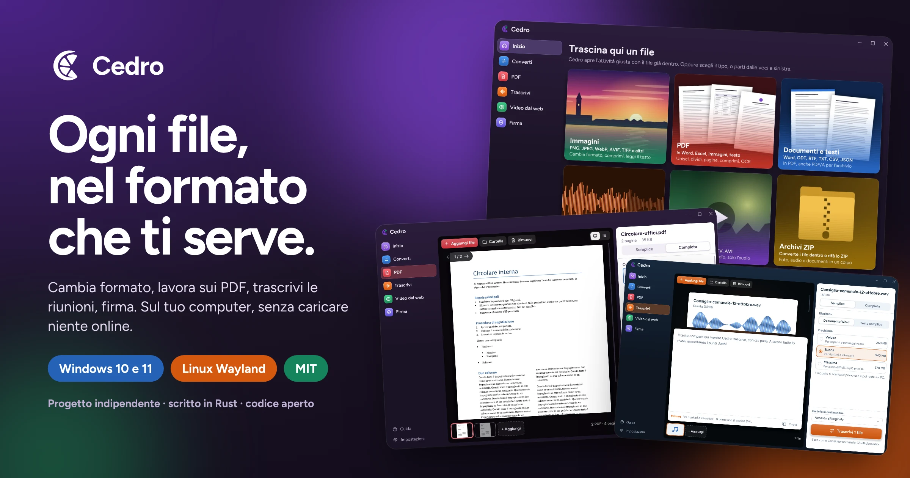
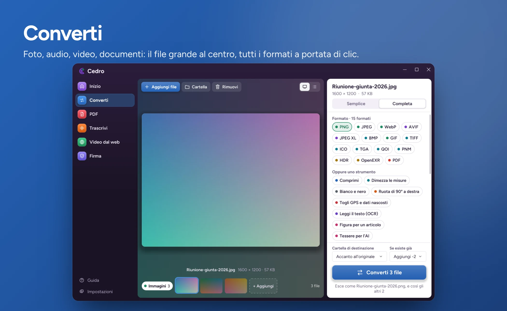
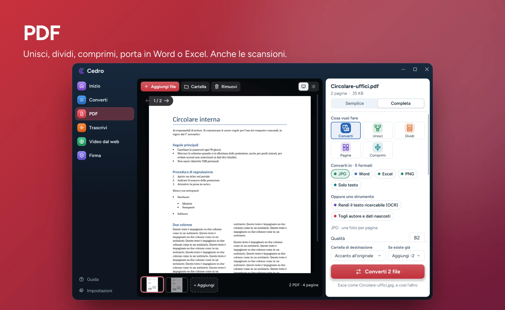
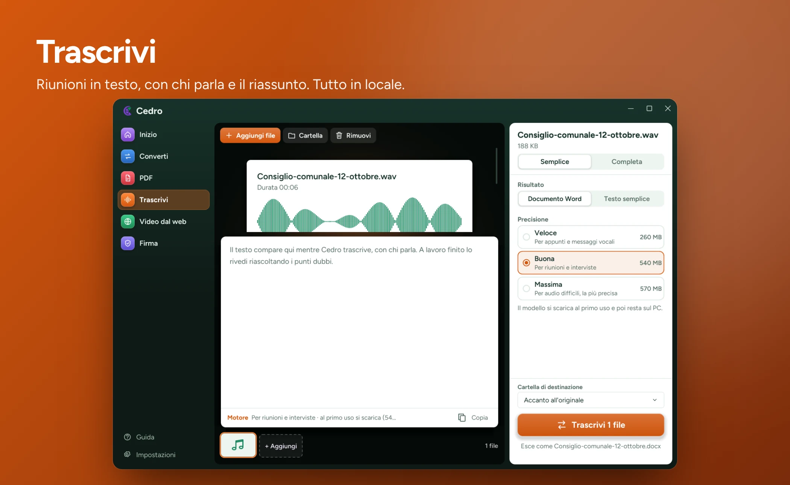
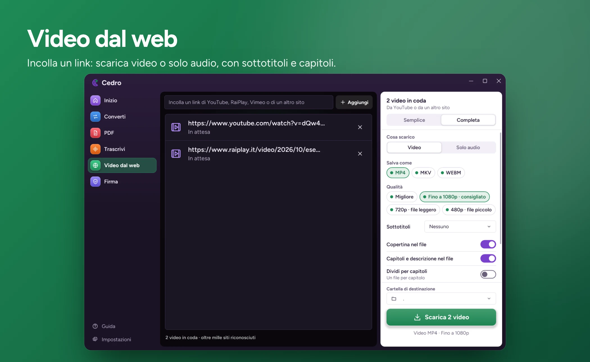
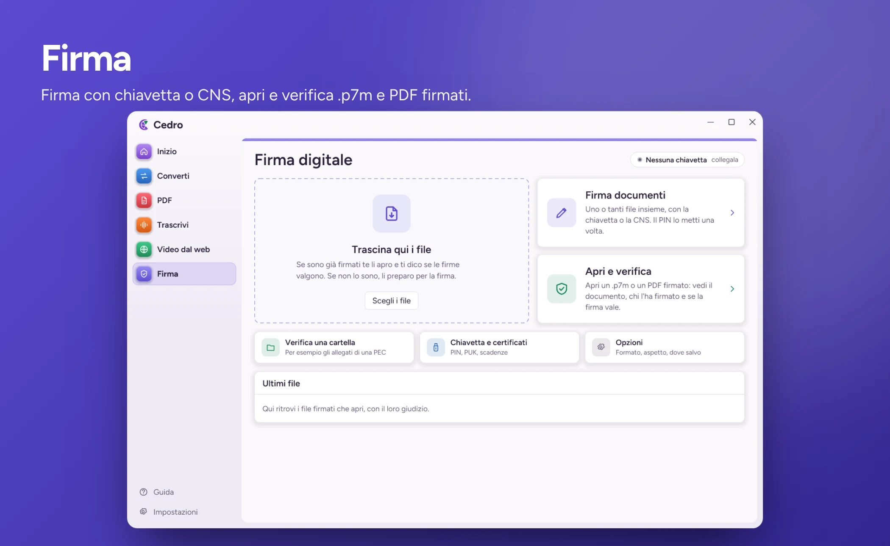
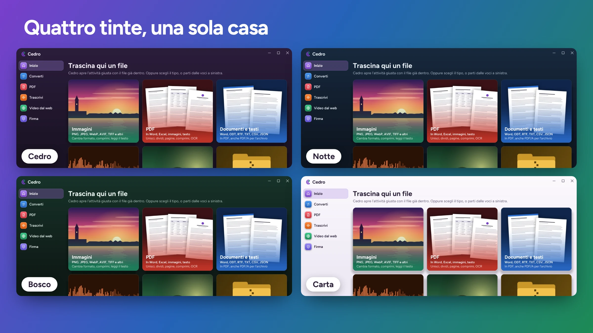
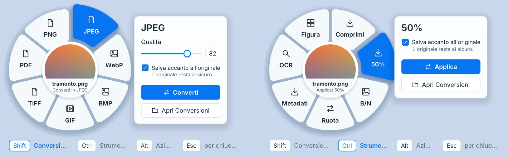
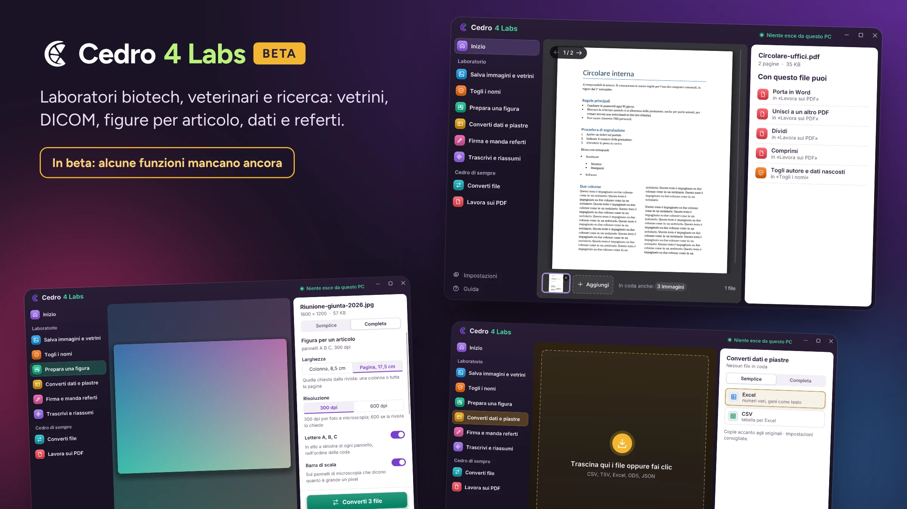

<p align="right"><a href="README.en.md">🇬🇧 English</a> · 🇮🇹 Italiano</p>

<p align="center">
  
</p>

<p align="center">
  <a href="https://github.com/realfulvio/cedro/releases/latest"></a>
  
  
  <a href="#cedro-4-labs-beta"></a>
  <a href="https://github.com/realfulvio/cedro/releases/latest"></a>
  <a href="LICENSE"></a>
</p>

<p align="center">
  <a href="#scarica-e-installa"><b>⬇ Scarica</b></a>
  &nbsp;·&nbsp; <a href="#come-si-usa">Come si usa</a>
  &nbsp;·&nbsp; <a href="#cosa-converte">Formati</a>
  &nbsp;·&nbsp; <a href="#più-di-una-conversione">Strumenti</a>
  &nbsp;·&nbsp; <a href="#trascrizione-e-riassunto">Trascrizione</a>
  &nbsp;·&nbsp; <a href="#cedro-4-labs-beta">Cedro 4 Labs</a>
  &nbsp;·&nbsp; <a href="#tutti-i-rilasci">Rilasci</a>
  &nbsp;·&nbsp; <a href="#domande">Domande</a>
</p>

## Cos'è

**Cedro è un programma a sé: un progetto unico nel suo genere e indipendente.** Non è la copia di un convertitore e non dipende da servizi online né da altri programmi: è scritto da zero, interamente in **Rust**, con un motore suo per immagini, PDF, documenti, audio e video. Il codice è aperto, l'interfaccia è in italiano e in inglese (segue la lingua del sistema).

Un'unica finestra, tante attività: **cambia formato** a foto, audio, video e documenti; **lavora sui PDF** (unisci, dividi, comprimi, porta in Word o Excel, anche le scansioni con l'OCR); **trascrive le riunioni**, riconosce **chi parla** e scrive il **riassunto**; **scarica video e audio** dal web; **firma** con chiavetta o smart card (CNS) e verifica i file firmati. Il file resta al centro, i comandi sono tutti in vista, e la copia nuova compare accanto all'originale, che non si tocca.

Tutto avviene **sul tuo computer**: i file non vengono caricati da nessuna parte.

Sei un laboratorio biotech, veterinario o di ricerca? C'è anche **[Cedro 4 Labs](#cedro-4-labs-beta)**, ora in beta.

## Come appare

<p align="center">
  
  
</p>
<p align="center">
  
  
</p>
<p align="center">
  
  
</p>

Dalla 0.44 l'aspetto predefinito è il nuovo **Cedro** a pagine, con quattro tinte (Cedro, Notte, Bosco, Carta) e la vista **Semplice** o **Completa** a un clic. I cinque aspetti precedenti, compreso quello del **Comune di Bondeno**, restano in *Impostazioni › Aspetto*.

## Scarica e installa

| Il tuo dispositivo | Cosa scaricare |
| --- | --- |
| **Windows 10 e 11** | [`Cedro-Setup-….exe`](https://github.com/realfulvio/cedro/releases/latest) |
| **Windows 10 e 11, portable** | [`Cedro-Portable-….-x64.zip`](https://github.com/realfulvio/cedro/releases/latest): estrai e apri `cedro.exe`, niente da installare; dati e impostazioni restano nella cartella `Dati` accanto all'exe (solo x64) |
| **Windows on ARM** | in pausa: l'ultima versione è la 0.39.1, dalla 0.40 le release sono solo x64 |
| **Linux** (Wayland con KDE Plasma o GNOME) | [`cedro-….-linux-x64.tar.gz`](https://github.com/realfulvio/cedro/releases/latest): estrai e lancia `./install.sh`, senza permessi di amministratore |
| **Android** | sviluppo in pausa (ultima: 0.28.0): APK firmato dalle [release](https://github.com/realfulvio/cedro/releases?q=android-v) e repository F-Droid nostro `https://realfulvio.github.io/cedro/fdroid/repo`. Mai su Google Play |

**Windows:** doppio clic sull'installatore (si installa solo per il tuo utente, senza diritti di amministratore). Alla prima esecuzione Windows può dire «Windows ha protetto il PC», perché l'installatore non è ancora firmato: *Ulteriori informazioni*, poi *Esegui comunque*. A fine installazione lascia spuntato **Avvia Cedro**: non si apre una finestra, compare l'icona vicino all'orologio.

**Linux:** Cedro resta nell'area di notifica e scrive da solo i menu del file manager. Su GNOME serve l'estensione AppIndicator per vedere l'icona.

Dopo la prima installazione si aggiorna da solo. Per toglierlo: *Impostazioni di Windows, App, Cedro* (Linux: `./install.sh --uninstall`).

**Controllo antivirus:** ogni file di ogni release viene analizzato in automatico su [VirusTotal](https://www.virustotal.com) con più di 70 antivirus; il risultato, con il link al rapporto di ciascun file, è in fondo alle note della [release](https://github.com/realfulvio/cedro/releases/latest). Nessuno può garantire «zero virus» per sempre, ma puoi verificarlo tu stesso: confronta anche lo SHA-256 del file scaricato con quello del rapporto.


## La ruota con il clic destro

Oltre alla finestra, Cedro ha la **ruota**: si accende in *Impostazioni › Ruota*.

1. Tieni premuto un tasto.
2. Fai **clic destro** su un file: in Esplora file, sul desktop, nel file manager o in una finestra Apri/Salva.
3. Clic sinistro sulla fetta che vuoi. Esc, o un clic fuori dalla ruota, annulla.

| Tasto | Ruota | Cosa fa |
| --- | --- | --- |
| **Shift** | Conversione | Cambia formato: foto, documenti, PDF, audio, video |
| **Ctrl** | Strumenti | Comprime, scala, bianco e nero, ruota, toglie i metadati, legge il testo (OCR) |
| **Alt** | Azioni | Duplica, copia il percorso, crea uno ZIP |

Le fette cambiano con il tipo di file. Se non sai da dove partire, apri la **Guida** dall'icona: sei passi animati.

<p align="center">
  
</p>


## Cosa converte

| Tipo | Formati | Con Shift |
| --- | --- | --- |
| Immagini | PNG, JPEG, WebP, AVIF, JPEG XL, **SVG**, BMP, GIF, TIFF, ICO, TGA, QOI, PNM, HDR, OpenEXR, DDS | altro formato, PDF con testo cercabile; nel pannello Conversioni anche AVIF, JPEG XL (senza perdita), ICO, TGA, QOI, PNM, HDR, OpenEXR |
| Documenti | DOCX, DOC, ODT, RTF | PDF |
| Testo | TXT, MD, CSV, JSON, HTML, XML | altro testo, PDF |
| PDF | PDF | JPG, **Word modificabile** |
| Audio | WAV, MP3, OGG, **Opus**, M4A, AAC, FLAC, AIFF, CAF | WAV, MP3; nel pannello anche FLAC, Opus, AIFF |
| Video | MP4, WebM, MOV, MKV, AVI | MP4 |
| Archivi | ZIP | foto in WebP/JPEG/PNG, audio in MP3/WAV, documenti in PDF: converte i file dentro lo ZIP e lo rifà |

**PDF in Word:** titoli con stili veri, paragrafi, tabelle vere (celle, sfondi, bordi, intestazione ripetuta tra le pagine), elenchi puntati e numerati, testo su più colonne e grafici al loro posto, modificabili come in un editor professionale. Le scansioni vengono lette con l'OCR in italiano.
**Foto dal telefono:** vengono raddrizzate in automatico.
**Riconosce i file dal contenuto:** una foto WebP chiamata «.jpg» si converte lo stesso. **Nome dei file a modello** (`%nome%_%data%`) nel pannello Conversioni.

## Più di una conversione


**Conversioni.** Dal menu dell'icona apri il pannello: trascini file anche di tipi diversi, scegli formato, strumenti, qualità e cartella, e premi il pulsante in basso. Ogni categoria ha le sue opzioni: foto (dimensioni, raddrizza, sfondo bianco), documenti (formato pagina, caratteri incorporati, segnalibri, PDF/A-1b validato con veraPDF, password), PDF (OCR, tabelle, colonne, pagine come `1-3,5`, risoluzione), testo, audio (kbps, canali, volume, tagli, tag) e video (risoluzione, fps, senza audio, ottimizzato per il web). Se il nome esiste già: aggiungi `-2`, sostituisci, salta o chiedi ogni volta.

### Trascrizione e riassunto


**Trascrizione.** Da audio e video a un documento Word, a un testo o ai sottotitoli, in italiano e in locale (whisper.cpp). Sceglie da solo la variante giusta per il tuo processore e usa la scheda video con Vulkan quando c'è. Tre livelli di precisione, e una barra di avanzamento con il tempo che resta.

**Chi parla.** Riconosce gli interlocutori e li colora; dai un nome a ogni voce nella scheda «Chi parla» e il nome vale in tutto il documento.

**Riassunto AI.** Con un clic un piccolo modello in italiano (llama.cpp, Qwen3.5-4B) scrive il riassunto e «chi ha detto cosa». Si carica solo quando lo chiedi e poi si spegne. Cifre e voti dubbi sono segnati *da controllare*.


Componenti esterni come yt-dlp, deno, ffmpeg e il motore di trascrizione si scaricano al primo uso e si **aggiornano da soli**; le licenze sono in *Informazioni*.

## Cedro 4 Labs (beta)

<p align="center">
  
</p>

**Cedro 4 Labs** è l'aspetto di Cedro pensato per laboratori biotech, veterinari e di ricerca, e per il loro ufficio: sei attività al posto dei tipi di file («Salva immagini e vetrini», «Togli i nomi», «Prepara una figura», «Converti dati e piastre», «Firma e manda referti», «Trascrivi e riassumi»), più le pagine di sempre. Si sceglie nell'installatore o in *Impostazioni › Aspetto*.

> ⚠️ **È in fase beta: alcune funzionalità mancano ancora e altre vanno rifinite.** Se lo usi in laboratorio, controlla i risultati e segnalaci cosa non torna.

| | Cosa c'è già | Cosa manca |
| --- | --- | --- |
| Immagini | Vetrini digitali `.svs` in immagine, DICOM (anche anonimizzato), Zeiss CZI, ND2 e LIF, OME-TIFF, figura per articolo con barra di scala | Hamamatsu NDPI, 3DHistech MRXS, VSI; DICOM da CD con DICOMDIR |
| Dati | CSV/TSV ↔ Excel, pacchetto dati con impronte SHA-256 (BagIt) | Mappa delle piastre a colori |
| Privacy | Toglie nomi, autori, GPS e dati nascosti da PDF, Office, foto e DICOM | Altri formati proprietari |
| Voce | Trascrizione con glossario veterinario, riassunto | Rifinitura dei referti |

Tutto resta sul computer, come in Cedro standard. Un laboratorio che manca di un formato o di una funzione può [aprire una segnalazione](https://github.com/realfulvio/cedro/issues).

## Tutti i rilasci

Dal 21 ottobre 2026 sono uscite **90 versioni** per Windows e Linux. Le ultime:

| Versione | Data | Novità |
| --- | --- | --- |
| [0.45.0](https://github.com/realfulvio/cedro/releases/tag/v0.45.0) | 12/11 | Cedro 4 Labs legge i file Zeiss CZI |
| [0.44.2](https://github.com/realfulvio/cedro/releases/tag/v0.44.2) | 12/11 | Correzioni di qualità per Cedro 4 Labs |
| [0.44.0](https://github.com/realfulvio/cedro/releases/tag/v0.44.0) | 12/11 | Nuovo aspetto «Cedro» a pagine con quattro tinte |
| [0.43.0](https://github.com/realfulvio/cedro/releases/tag/v0.43.0) | 12/11 | Cedro 4 Labs con la finestra a pagine |
| [0.42.0](https://github.com/realfulvio/cedro/releases/tag/v0.42.0) | 12/11 | Funzioni per i laboratori (DICOM, ND2/LIF, figura, pacchetto dati) |
| [0.41.0](https://github.com/realfulvio/cedro/releases/tag/v0.41.0) | 12/11 | Versione portable per Windows |
| [0.40.0](https://github.com/realfulvio/cedro/releases/tag/v0.40.0) | 12/11 | Tema Cedro 4 Labs e scelta dell'aspetto nell'installatore |
| [0.39.0](https://github.com/realfulvio/cedro/releases/tag/v0.39.0) | 11/11 | Vetrini digitali (.svs) |
| [0.38.0](https://github.com/realfulvio/cedro/releases/tag/v0.38.0) | 10/11 | Firma con chiavetta USB o smart card |
| [0.31.0](https://github.com/realfulvio/cedro/releases/tag/v0.31.0) | 03/11 | Riassunto AI delle riunioni |
| [0.26.10](https://github.com/realfulvio/cedro/releases/tag/v0.26.10) | 29/10 | Unire e dividere i PDF |
| [0.22.0](https://github.com/realfulvio/cedro/releases/tag/v0.22.0) | 27/10 | Interfaccia in inglese |
| [0.6.0](https://github.com/realfulvio/cedro/releases/tag/v0.6.0) | 21/10 | Cedro arriva su Linux |
| [0.1.0](https://github.com/realfulvio/cedro/releases/tag/v0.1.0) | 21/10 | Prima versione |

**[→ Il registro completo, versione per versione](docs/RILASCI.md)** · [tutte le release su GitHub](https://github.com/realfulvio/cedro/releases)

## Domande

**Cambia il file originale?** No, crea sempre una copia accanto.
**Serve internet?** Solo per gli aggiornamenti e per scaricare i componenti la prima volta (e, ovviamente, per YouTube e Video dal web).
**Perché Windows mi avvisa?** L'installatore non ha ancora la firma digitale a pagamento. Il codice è aperto e lo puoi controllare qui.
**E su Mac?** Per ora no: Windows e Linux (Wayland). Android è in pausa.

---

## Per chi sviluppa

<details>
<summary><b>Compilare, riga di comando, sicurezza, licenze</b></summary>

### Compilare

Serve [Rust](https://rustup.rs).

```
cargo build --release
```

- **Windows:** strumenti di compilazione Microsoft C++. Per l'installatore serve [Inno Setup 6](https://jrsoftware.org/isinfo.php) e `pwsh installer\build.ps1` (con `-Arm64` per Windows on ARM; il motore di trascrizione ARM64 si compila con `trascrivi\build.ps1` su un PC ARM e richiede anche LLVM).
- **Linux:** compilatore C, `pkgconf` e i pacchetti di sviluppo di GTK 4. La prima volta compila anche OpenH264, FDK AAC e LAME. Avvia `cedro` una volta: resta nella tray e scrive i menu del file. Su GNOME serve l'estensione AppIndicator per l'icona.
  - Pacchetto: `installer/build-linux.sh` crea `dist/cedro-<versione>-linux-x64.tar.gz` (programma, licenze e `install.sh`, che installa per l'utente senza permessi di amministratore).
  - Trascrizione: il motore (whisper.cpp) si compila a parte con `trascrivi/build.sh`, una variante per tipo di processore (`base`, `avx2`, `avxvnni`, `avx512`, `avx512vnni`) e `vulkan` per la scheda video. Servono cmake e clang (libopus è compilata dentro); per Vulkan gli header, `glslc` e il caricatore. I file `cedro-trascrivi-<versione>-linux-x64-<variante>` vanno nella release: Cedro li scarica alla prima trascrizione.

Le impostazioni stanno in `%APPDATA%\Cedro\config.txt` (Windows) e `~/.config/cedro/config.txt` (Linux).

### Riga di comando

```
cedro convert foto.png webp
cedro tool foto.png compress --quality 70
cedro zip nota.txt
cedro update
cedro show --conversione foto.png   # Linux: apre la ruota
```

### Sicurezza

Codice aperto (MIT), nessun packer né offuscamento, nessuna rete oltre al controllo aggiornamenti. Gli hook del mouse e della tastiera restano nel processo di Cedro e non iniettano DLL in altri programmi. L'exe non è firmato Authenticode: SmartScreen avvisa la prima volta, ma non è un rilevamento di malware.

### Licenze

Cedro è MIT. Alcune parti hanno la propria licenza: LAME (LGPL, MP3), modello OCR ocrs (CC BY-SA 4.0, fonti in `models/FONTI.txt`), [oxideav-vp8](https://github.com/OxideAV/oxideav-vp8), [oxideav-vp9](https://github.com/OxideAV/oxideav-vp9) e [oxideav-webp](https://github.com/OxideAV/oxideav-webp) (MIT), OpenH264 (BSD-2) e FDK AAC (licenza Fraunhofer). Cedro è un'implementazione scritta da zero e non usa codice, icone o testi di altri convertitori.

</details>

---

## Crediti

Cedro è un progetto di **Luca «Realhcok» A.**, scritto in Rust da zero: non usa codice, icone o testi di altri convertitori. Font [Figtree](https://github.com/erikdkennedy/figtree) e Titillium Web (SIL OFL), logo e kit grafico hcok. Un grazie al **Comune di Bondeno** per il tema dedicato. Le licenze delle componenti di terze parti sono in [`LICENZE-DI-TERZE-PARTI.txt`](LICENZE-DI-TERZE-PARTI.txt) e nella scheda *Informazioni* di Cedro.

<p align="center">
  Powered by Luca "Realhcok" A.
</p>
