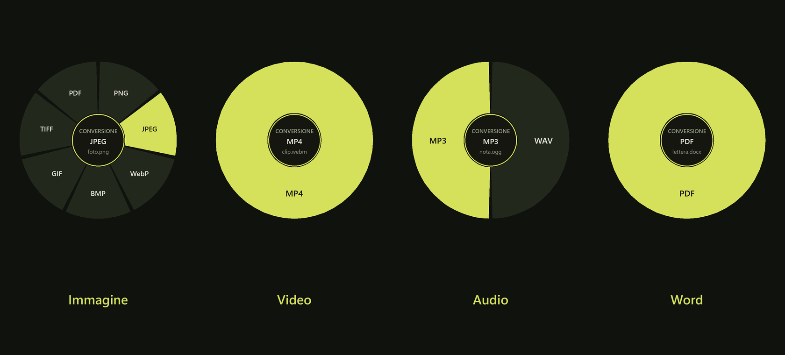
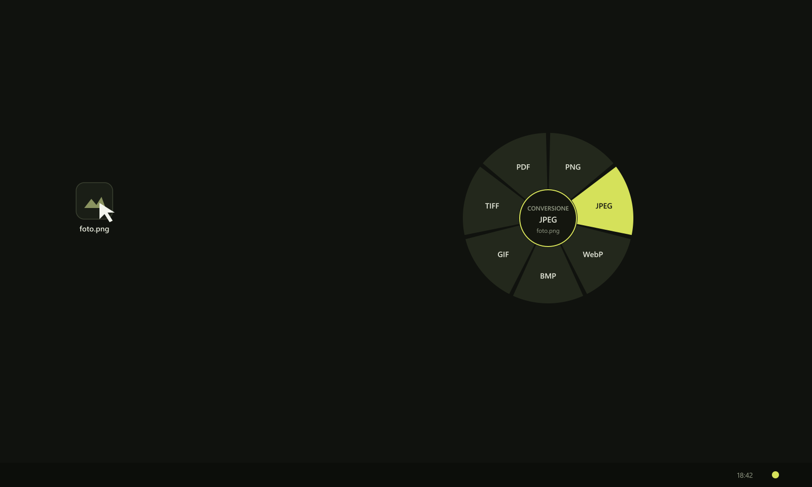
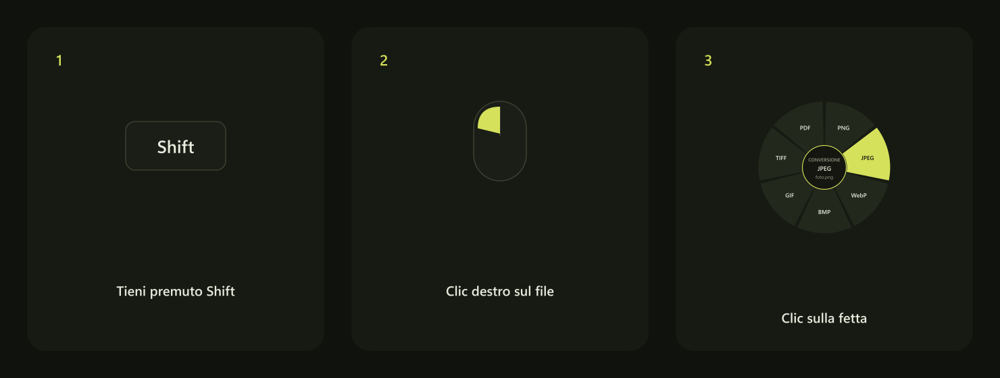
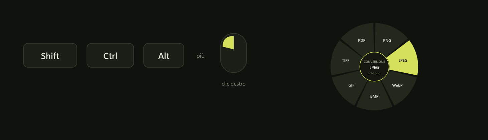
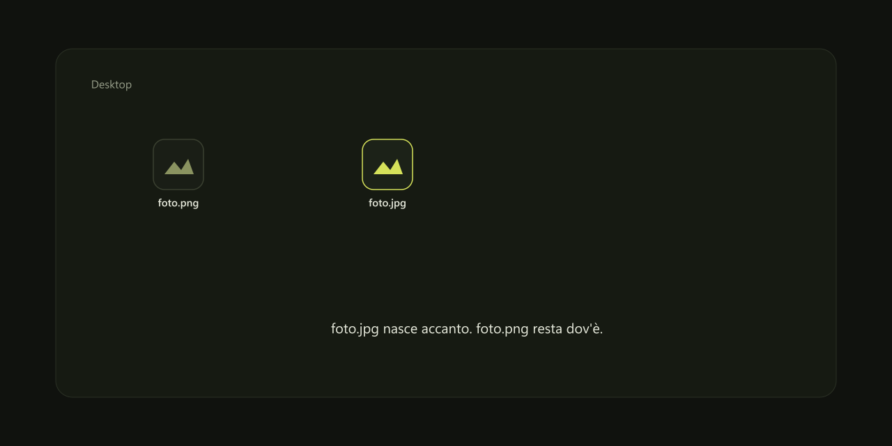
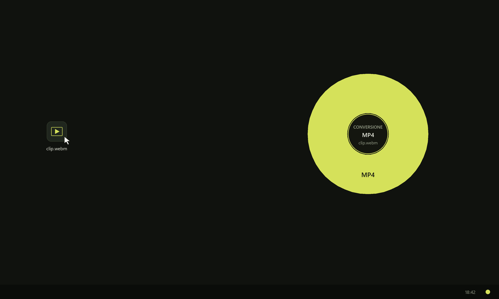

<p align="center">
  
</p>

# Cedro

Tasto destro su un file, più un tasto. Si apre una ruota sul cursore. Si molla sulla fetta e il file viene convertito lì, sul PC. Nessun caricamento.

Cedro fa le conversioni da solo. Non serve installare LibreOffice, ffmpeg, Tesseract o Poppler. Gira su Windows e su Linux.

Cedro non è Tangerine e non ne usa codice, icone o testi. Licenza [MIT](LICENSE).

## Novità della 0.7.1

- La ruota si apre di nuovo dal desktop anche con un overlay trasparente a schermo intero, come quello di NVIDIA (GeForce Overlay). Prima quell'overlay "copriva" le icone e Cedro non trovava il file.

## Novità della 0.7

- Su Windows c'è un installatore: `Cedro-Setup-0.7.1.exe`, nella pagina della release. Non serve più compilare.
- Il programma ha la sua icona, nell'exe, nel menu Start e sul desktop.
- La ruota torna ad aprirsi dalle finestre di Esplora file di Windows 11 recenti, schede comprese. Cedro leggeva la cartella aperta con un metodo che lì non funzionava più e, in certi casi, si chiudeva da solo.

## Novità della 0.6

Cedro gira anche su Linux, su GNOME e su KDE Plasma.

- La ruota si apre dal menu del file. In Dolphin sta sotto **Cedro**. In Nautilus sta sotto **Script**. Su Wayland il clic destro di un altro programma non si può prendere.
- Il video diventa MP4 dentro il programma. Su Linux scrivono OpenH264 e FDK AAC, anche per un MKV già in H.264. Su Windows restano i codificatori di Windows.
- Un MP4, un MOV o un MKV che ha già l’audio AAC lo tiene nel file nuovo. Su Linux un MOV di QuickTime viene convertito lo stesso: Cedro legge i fotogrammi H.264 e l’audio AAC.
- Senza argomenti, `cedro` resta nella tray. `cedro show` apre la ruota e, a lavoro finito, esce.

Le conversioni che la ruota offre vanno a buon fine.

- Un WebM VP8 o VP9 diventa MP4. Cedro legge il video e scrive H.264 e AAC. Su Windows usa i codificatori di Windows. Su Linux usa OpenH264 e FDK AAC, compilati nel programma. L’audio del file resta.
- Un AVI non compresso, o in MJPEG, diventa MP4 anche se Windows non ha il convertitore di colore.
- Il vecchio DOC viene letto, e anche i testi in Windows-1252 e UTF-16.
- Un file Opus non viene offerto: il programma non lo sa ancora leggere.
- Se i file selezionati sono di tipi diversi, Cedro converte quelli del primo e lascia stare gli altri.
- Da Word o da PDF esce il testo. L’impaginazione originale no.

<p align="center">
  
</p>

## Su Windows

1. Dalla [pagina delle release](https://github.com/realfulvio/cedro/releases/latest) scarica **Cedro-Setup-0.7.1.exe**.
2. Doppio clic. L'installazione è per il tuo utente, senza diritti di amministratore, in `%LOCALAPPDATA%\Programs\Cedro`. Crea il collegamento nel menu Start. Il collegamento sul desktop e l'avvio con Windows sono opzioni da spuntare.
3. La prima volta Windows può dire «Windows ha protetto il PC»: l'installatore non è firmato. Clicca «Ulteriori informazioni», poi «Esegui comunque».
4. Alla fine lascia spuntato **Avvia Cedro**. Non si apre una finestra: vicino all'orologio compare l'icona. Se non la vedi, apri la freccia delle icone nascoste.
5. In una cartella qualsiasi, sul desktop o in una finestra Apri/Salva, tieni premuto **Shift** e fai clic destro su un file. Si apre la ruota. Clic sinistro sulla fetta. La copia compare nella stessa cartella. L'originale resta dov'è.
6. Per chiudere: clic sull'icona vicino all'orologio, poi **Esci**. Per disinstallare: Impostazioni, App, Cedro.

Senza argomenti, `cedro` resta nella tray. `cedro show` apre la ruota e, a lavoro finito, esce.

### Compilare da soli

Serve [Rust](https://rustup.rs) con gli strumenti di compilazione Microsoft C++ («Sviluppo di applicazioni desktop con C++»). Dalla cartella del codice:

```
cargo build --release
```

Il programma è `target
elease\cedro.exe`. Per rifare anche l'installatore serve [Inno Setup 6](https://jrsoftware.org/isinfo.php):

```
pwsh installeruild.ps1
```

Il risultato è `dist\Cedro-Setup-<versione>.exe`.

## Su Linux

Wayland non lascia a Cedro il clic destro di un altro programma. La ruota si apre dal menu del file, in GNOME e in Plasma. Le conversioni sono le stesse, video compreso.

1. Installa Rust da [rustup.rs](https://rustup.rs), più gli strumenti per compilare C e i pacchetti di sviluppo di GTK 4 (`gtk4`, `pkgconf` e un compilatore C).
2. Nella cartella del codice:

```
cargo build --release
```

La prima volta compila anche OpenH264, FDK AAC, LAME e i lettori VP8 e VP9. Può durare parecchio.

3. Il programma è `target/release/cedro`.
4. Avvialo una volta senza argomenti. Resta nella tray e scrive i menu. Su Plasma l’icona compare. Su GNOME serve l’estensione AppIndicator: senza quella il menu del file funziona lo stesso.
5. In Dolphin, tasto destro sul file, poi **Cedro** e **Conversione**, **Strumenti** o **Azioni**. Se il menu non compare, chiudi Dolphin e riaprilo.
6. In Nautilus, tasto destro, **Script** e la cartella **Cedro**. Con `python-nautilus` compare anche la voce **Cedro**.
7. La ruota si apre a schermo. Mentre è aperta, **Shift**, **Ctrl** e **Alt** cambiano le fette. Clic sinistro sulla fetta. Esc, il centro o un punto fuori annulla.
8. Finito il lavoro, questa finestra si chiude. L’icona nella tray è quella dell’avvio senza argomenti. Per chiuderla: clic sull’icona, poi **Esci**. Cedro non si avvia da solo all’ingresso.

La configurazione sta in `~/.config/cedro/config.txt`.

## Come si usa

<p align="center">
  
</p>

<p align="center">
  
</p>

1. Avvia `cedro.exe`. Resta nella tray, senza una finestra di lavoro.
2. In Esplora file, sul desktop o in una finestra Apri/Salva, tieni premuto un tasto e fai clic destro sul file. Vale per qualsiasi cartella, non solo per il desktop.
3. La ruota resta aperta anche se molli il tasto. Vai su una fetta e fai clic sinistro. Oppure tieni premuto il destro, spostati sulla fetta e rilascia.
4. Esc, un clic al centro o fuori dalla ruota annulla.

<p align="center">
  
</p>

| Tasto | Ruota | A cosa serve |
| --- | --- | --- |
| **Shift** | Conversione | Sceglie il formato nuovo, secondo il tipo di file |
| **Ctrl** | Strumenti | Comprimi, scala, bianco e nero, ruota, metadati, OCR, maiuscole |
| **Alt** | Azioni | Duplica, copia il percorso, ZIP |


Le fette cambiano con il file. Su una foto, Shift mostra PNG, JPEG, WebP, BMP, GIF, TIFF e PDF. Su un audio mostra WAV e MP3. Su un video mostra MP4. Su un Word mostra PDF. Su un PDF mostra Word e Testo.

Si può anche trascinare il file con il tasto sinistro e premere Shift, Ctrl o Alt. Su Windows, se Shift resta premuto mentre si rilascia un trascinamento, Esplora file può spostare il file. Con il clic destro questo non succede.

Il file viene letto dalla cartella aperta in quel momento: desktop, un disco, una chiavetta, Documenti, Download, una finestra di dialogo. Se sotto il cursore non c’è un file, Cedro lo dice e non fa nulla. Non entra negli altri programmi: in un browser o in un editor il clic destro resta quello di Windows.

## Dove finisce il file



La copia viene scritta nella stessa cartella dell’originale. L’originale non viene sovrascritto. Se il nome esiste già, Cedro aggiunge `-2`, `-3`, e così via.

## Cosa fa

Immagini (PNG, JPEG, WebP, BMP, GIF, TIFF): conversione, PDF, compressione JPEG, scala 50%, bianco e nero, rotazione 90°, riscrittura senza metadati. Con Ctrl, la fetta OCR legge il testo. Il modello è latino: legge le lettere, non un vocabolario italiano.

Testo (TXT, MD, CSV, TSV, JSON, LOG, XML, HTML): altro testo, PDF, maiuscolo, minuscolo.

Word (DOC, DOCX, ODT, RTF): PDF di testo. Restano paragrafi e parole. Impaginazione, font incorporati e caselle di testo no. Il vecchio DOC viene letto dall’indice pubblico del formato Word.

PDF: con Shift, Word di testo oppure un file di testo. La pagina non viene ricostruita. Con Ctrl, OCR: se il PDF ha già del testo, Cedro lo copia; se non ne ha, disegna al massimo 20 pagine e le legge.

Audio (WAV, MP3, OGG, M4A, AAC, FLAC): WAV e MP3. L’MP3 è LAME, compilato dentro l’eseguibile, licenza LGPL. Un file Opus non viene convertito.

<p align="center">
  
</p>

Video (MP4, WebM, MOV, MKV, AVI): MP4 con H.264 e AAC. Su Windows, H.264, MJPEG e i video non compressi passano dai codificatori di Windows. Su Linux li scrivono OpenH264 e FDK AAC, compilati nel programma. Vale anche per un MKV già in H.264: Cedro lo legge e lo riscrive. Un MP4, un MOV o un MKV con audio AAC tiene il sonoro. Su Linux, se il MOV usa la descrizione audio di QuickTime, Cedro legge i fotogrammi H.264 e l’audio AAC. WebM VP8 e VP9 li legge Cedro e li riscrive in H.264, con l’audio messo in AAC. Non è un ffmpeg a parte. Su Windows, se manca il codificatore H.264 (capita su alcune edizioni N), la ruota lo dice e non scrive un file a metà.

Azioni su qualsiasi file: duplica, copia il percorso, ZIP non compresso (metodo store).

HEIC non è nel motore. Il PDF scritto da Cedro per un’immagine o per un testo semplice non è un PDF/A.

## Riga di comando

La qualità JPEG, da 40 a 95, sta in `%APPDATA%\Cedro\config.txt` su Windows e in `~/.config/cedro/config.txt` su Linux:

```
quality=82
```

Si può anche convertire senza la ruota. Su Windows, dalla cartella del programma:

```
target\release\cedro.exe convert foto.png webp
target\release\cedro.exe tool foto.png compress --quality 70
target\release\cedro.exe tool nota.txt upper
target\release\cedro.exe zip nota.txt
```

Senza argomenti, `cedro.exe` apre la ruota nella tray.

Su Linux i percorsi usano la barra normale:

```
target/release/cedro convert foto.png webp
target/release/cedro show --conversione foto.png
```

Senza argomenti, `cedro` resta nella tray. `cedro show` apre la ruota e, a lavoro finito, esce.

## Antivirus

- Codice aperto, licenza MIT, niente packer, niente UPX, niente offuscamento.
- Gli hook sono `WH_MOUSE_LL` e `WH_KEYBOARD_LL`. Restano nel processo di Cedro e non iniettano una DLL in Esplora file o in altri programmi. Il clic destro con Shift, Ctrl o Alt viene intercettato sul desktop, in ogni finestra di Esplora file e nelle finestre Apri/Salva. Il nome del file si legge dalla cartella di quella finestra, senza scrivere nella memoria di un altro processo. Il trascinamento, se lo usi, consegna il file con il drop OLE normale.
- Nessuna rete, nessuna telemetria, nessun download all’avvio. I modelli di lettura sono già nel programma.
- L’exe e l’installatore non sono firmati Authenticode. SmartScreen può dire «Windows ha protetto il PC» la prima volta: è la mancanza di firma, non un rilevamento di malware. «Esegui comunque» vale per quella copia. Una firma Authenticode da autorità pubblica costa e non è inclusa.
- Compilare sul proprio PC evita l’hash di un exe scaricato da un posto sconosciuto, che è la causa più comune di falsi positivi.

## Licenze nel programma

Il codice di Cedro è MIT. Alcuni pezzi portano la propria licenza e restano separati.

- LAME, per l’MP3, è LGPL.
- I pesi del modello OCR sono CC BY-SA 4.0 (Robert Knight, ocrs). I link stanno in `models/FONTI.txt`.
- I lettori WebM sono [oxideav-vp8](https://github.com/OxideAV/oxideav-vp8) e [oxideav-vp9](https://github.com/OxideAV/oxideav-vp9), di Mark Karpelès, licenza MIT.
- OpenH264, di Cisco, è BSD-2. Su Linux Cedro compila i sorgenti e non scarica un binario.
- FDK AAC, di Fraunhofer, ha la licenza Fraunhofer. Il collegamento Rust è MIT. Cedro resta MIT.

[VERT](https://github.com/VERT-sh/VERT) è un convertitore nel browser, licenza AGPL-3.0. Cedro non ne include il codice: nessun suo file è stato copiato. L’MP4 usa la stessa coppia, H.264 e AAC: su Windows i codificatori di Windows, su Linux OpenH264 e FDK AAC. Per il WebM, i lettori oxideav.

## Indipendenza

L’interazione (tasto, clic destro, ruota, rilasciare) è un’idea di interfaccia. Cedro è una implementazione separata, scritta da zero.
