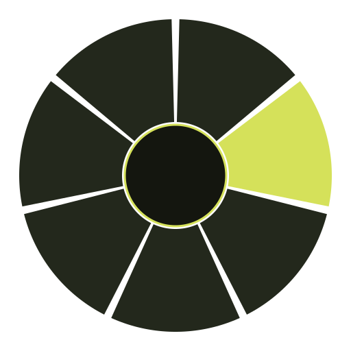
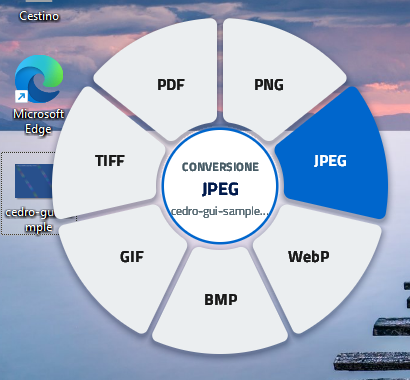
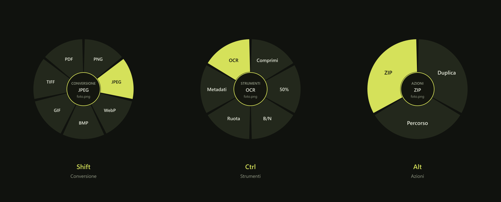
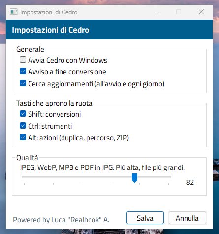

<p align="center">
  
</p>

<h1 align="center">Cedro</h1>

<p align="center">
  <strong>Cambia formato a un file con un clic destro.<br>Sul tuo PC, senza caricare nulla.</strong>
</p>

<p align="center">
  <a href="https://github.com/realfulvio/cedro/releases/latest"><b>⬇ Scarica per Windows</b></a>
  &nbsp;·&nbsp;
  <a href="#come-si-usa">Come si usa</a>
  &nbsp;·&nbsp;
  <a href="#cosa-converte">Formati</a>
</p>

<p align="center">
  <a href="https://github.com/realfulvio/cedro/releases/latest"></a>
  
  <a href="LICENSE"></a>
</p>

<p align="center">
  
</p>

## Cos'è

Cedro è un piccolo programma che vive vicino all'orologio. Tieni premuto **Shift**, fai **clic destro** su un file e si apre una ruota: scegli il formato e la copia nuova compare accanto all'originale. Fine.

- **Tutto sul tuo PC.** Nessun sito, nessun caricamento, nessuna telemetria.
- **Niente da installare in più.** Non servono LibreOffice, ffmpeg o altri programmi.
- **L'originale non si tocca.** Se il nome esiste già, Cedro aggiunge `-2`, `-3`…
- **In italiano**, anche l'OCR.


## Scarica e installa

1. Vai alla **[pagina delle versioni](https://github.com/realfulvio/cedro/releases/latest)** e scarica `Cedro-Setup-….exe`.
2. Doppio clic. Si installa solo per il tuo utente, **senza diritti di amministratore**.
3. La prima volta Windows può dire «Windows ha protetto il PC», perché l'installatore non è firmato. Clicca *Ulteriori informazioni*, poi *Esegui comunque*.
4. A fine installazione lascia spuntato **Avvia Cedro**. Non si apre una finestra: compare l'icona vicino all'orologio (se non la vedi, apri la freccia delle icone nascoste).


Per togliere Cedro: *Impostazioni di Windows, App, Cedro*. Dopo la prima installazione si aggiorna da solo.

## Come si usa

<p align="center">
  
</p>

1. Tieni premuto un tasto.
2. Fai **clic destro** su un file: in Esplora file, sul desktop o in una finestra Apri/Salva.
3. Clic sinistro sulla fetta che vuoi. Esc, o un clic fuori dalla ruota, annulla.

| Tasto | Ruota | Cosa fa |
| --- | --- | --- |
| **Shift** | Conversione | Cambia formato: foto, documenti, PDF, audio, video |
| **Ctrl** | Strumenti | Comprime, scala, bianco e nero, ruota, toglie i metadati, legge il testo (OCR) |
| **Alt** | Azioni | Duplica, copia il percorso, crea uno ZIP |

Le fette cambiano con il tipo di file. Se non sai da dove partire, apri la **Guida** dall'icona: una breve animazione mostra cosa fanno Shift, Ctrl e Alt.


## Cosa converte

| Tipo | Formati | Con Shift |
| --- | --- | --- |
| Immagini | PNG, JPEG, WebP, BMP, GIF, TIFF | altro formato, PDF con testo cercabile |
| Documenti | DOCX, DOC, ODT, RTF | PDF |
| Testo | TXT, MD, CSV, JSON, HTML, XML | altro testo, PDF |
| PDF | PDF | JPG, **Word modificabile** |
| Audio | WAV, MP3, OGG, M4A, AAC, FLAC | WAV, MP3 |
| Video | MP4, WebM, MOV, MKV, AVI | MP4 |

**PDF in Word:** titoli con stili veri, paragrafi, tabelle vere (celle, sfondi, bordi, intestazione ripetuta tra le pagine), elenchi puntati e numerati di Word, testo su più colonne e grafici al loro posto, modificabili come in un editor professionale. File leggeri. Le scansioni vengono lette con l'OCR in italiano.
**Foto dal telefono:** vengono raddrizzate in automatico.

## L'icona e le impostazioni

<p align="center">
  
</p>

Clic destro sull'icona (o doppio clic per le Impostazioni):

- **Impostazioni** (su Windows, sei sezioni a sinistra): avvio con Windows, avviso e cartella aperta a fine conversione; quali tasti aprono la ruota e se vale nelle finestre Apri/Salva; dove mettere la copia (stessa cartella, sottocartella «Cedro» o una cartella fissa) e se sostituire i file che esistono già; qualità di JPEG, WebP, MP3, risoluzione di PDF in JPG e forza di «Comprimi»; lingua e pagine al massimo dell'OCR; ricerca automatica degli aggiornamenti.
- **Guida:** l'animazione che spiega i tre tasti.
- **Controlla aggiornamenti:** Cedro lo fa anche da solo, verifica l'installatore e chiede prima di aggiornare.
- **Avvio automatico** ed **Esci**.


## Domande

**Cambia il file originale?** No, crea sempre una copia nella stessa cartella.
**Serve internet?** Solo per cercare gli aggiornamenti.
**Perché Windows mi avvisa?** L'installatore non ha la firma a pagamento. Il codice è aperto e lo puoi controllare qui.
**E su Linux?** Funziona su GNOME e KDE Plasma. La ruota si apre dal menu del file (in Dolphin sotto *Cedro*, in Nautilus sotto *Script*), perché Wayland non lascia intercettare il clic destro. Avvia `cedro` una volta: si apre la finestra delle Impostazioni (con la Guida) e resta nel vassoio, con il menu per impostazioni, guida, aggiornamenti e avvio automatico. Vedi [Compilare](#per-chi-sviluppa).

---

## Per chi sviluppa

<details>
<summary><b>Compilare, riga di comando, sicurezza, licenze</b></summary>

### Compilare

Serve [Rust](https://rustup.rs).

```
cargo build --release
```

- **Windows:** strumenti di compilazione Microsoft C++. Per l'installatore serve [Inno Setup 6](https://jrsoftware.org/isinfo.php) e `pwsh installer\build.ps1`.
- **Linux:** compilatore C, `pkgconf` e i pacchetti di sviluppo di GTK 4. La prima volta compila anche OpenH264, FDK AAC e LAME. Avvia `cedro` una volta: resta nella tray e scrive i menu del file. Su GNOME serve l'estensione AppIndicator per l'icona.

Le impostazioni stanno in `%APPDATA%\Cedro\config.txt` (Windows) e `~/.config/cedro/config.txt` (Linux).

### Riga di comando

```
cedro convert foto.png webp
cedro tool foto.png compress --quality 70
cedro zip nota.txt
cedro update
cedro show --conversione foto.png   # Linux: apre la ruota
```

### Sicurezza

Codice aperto (MIT), nessun packer né offuscamento, nessuna rete oltre al controllo aggiornamenti. Gli hook del mouse e della tastiera restano nel processo di Cedro e non iniettano DLL in altri programmi. L'exe non è firmato Authenticode: SmartScreen avvisa la prima volta, ma non è un rilevamento di malware.

### Licenze

Cedro è MIT. Alcune parti hanno la propria licenza: LAME (LGPL, MP3), modello OCR ocrs (CC BY-SA 4.0, fonti in `models/FONTI.txt`), [oxideav-vp8](https://github.com/OxideAV/oxideav-vp8) e [oxideav-vp9](https://github.com/OxideAV/oxideav-vp9) (MIT), OpenH264 (BSD-2) e FDK AAC (licenza Fraunhofer). Cedro è un'implementazione scritta da zero e non usa codice, icone o testi di altri convertitori.

</details>

---

<p align="center">
  Powered by Luca "Realhcok" A.
</p>
